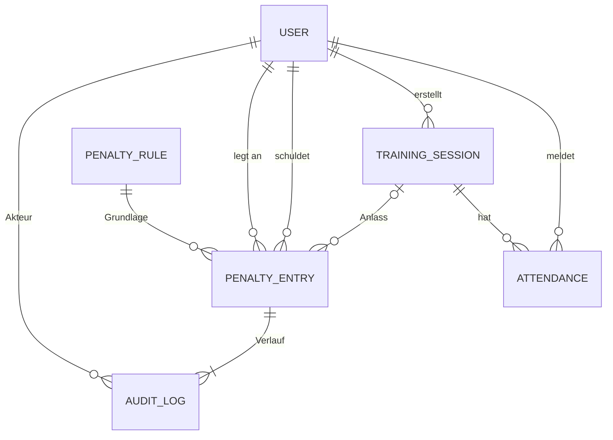
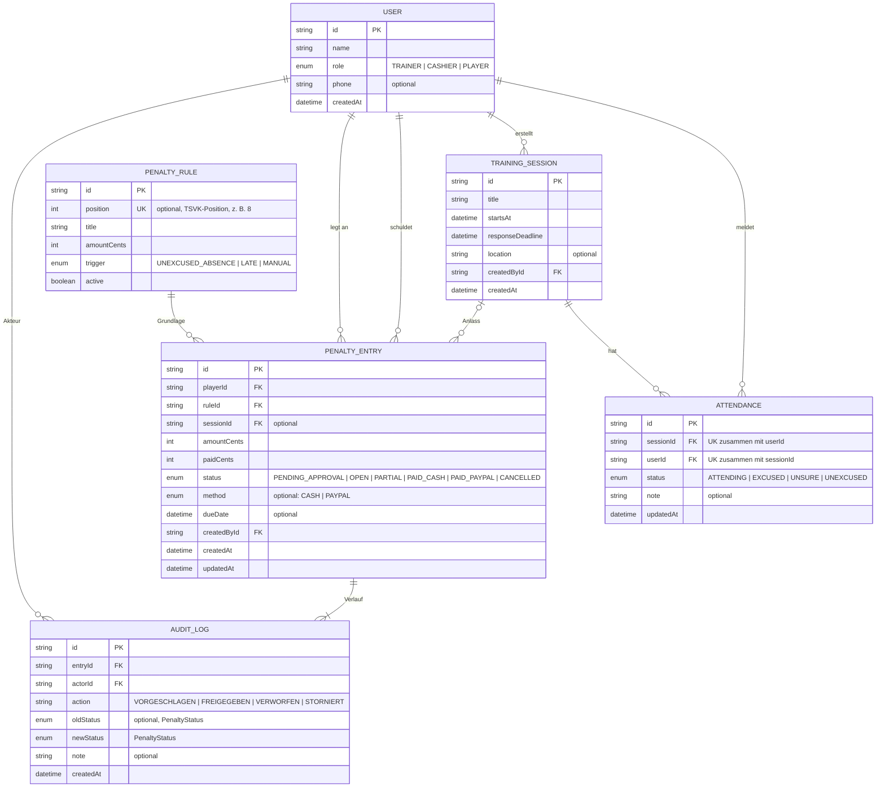

# Datenmodell: ER-Diagramm

> Stand 09.11.2026 (Audit-Log-Schutz seit 03.11.2026), entspricht exakt `prisma/schema.prisma`. PK = Primärschlüssel, FK = Fremdschlüssel, UK = eindeutig, „optional“ = darf leer sein (`?` im Schema).

## Übersicht

Dieselben sechs Tabellen und neun Beziehungen wie in der Übersicht des [Klassendiagramms](klassendiagramm.md); Namen siehe [Namensliste](namensliste.md).

## Detailansicht

Alle Tabellen mit Spalten, Schlüsseln und Beziehungen.

## Entscheidungen im Datenmodell

| Entscheidung | Grund (Quelle) |
| --- | --- |
| Beträge als Integer in Cent | keine Rundungsfehler bei Teilzahlungen |
| `PENDING_APPROVAL` als eigener Status | Trainer will erst bestätigen (Interview Trainer) |
| Zahlungsstatus statt Ja/Nein, inkl. `PARTIAL` | bar, PayPal und Teilzahlung (Interview Kassenwart) |
| `CANCELLED` statt Löschen | Storno bleibt nachvollziehbar (Interview Kassenwart, Akzeptanzkriterium 3) |
| `AuditLog` nur anlegen, nie ändern oder löschen; per Datenbank-Trigger erzwungen | wer hat wann was geändert (Interview Kassenwart), manipulationssicher (MVP-6, REQ-AUD-01) |
| jede Strafe hat mindestens einen Protokolleintrag (ER: „eins oder mehr“, Klassendiagramm: `1..*`) | die PenaltyEngine legt Strafe und Eintrag `VORGESCHLAGEN` in derselben Transaktion an; die Datenbank selbst erzwingt das nicht |
| Strafe mit Protokoll nicht löschbar (`onDelete: Restrict`) | Protokoll darf nicht über die Strafe mitgelöscht werden (REQ-AUD-01) |
| eine `Attendance` je Spieler und Training (`@@unique`) | 1-Klick-Rückmeldung überschreibt die alte |
| `note` optional | Absage ohne Rechtfertigungsdruck (Interview Spieler) |

Änderungen gegenüber der P2-Skizze: `PENDING` heißt jetzt `PENDING_APPROVAL`, `PARTIAL` und `CANCELLED` sind ergänzt, der Status `UNEXCUSED_ABSENT` aus der User Story heißt einheitlich `UNEXCUSED`.
