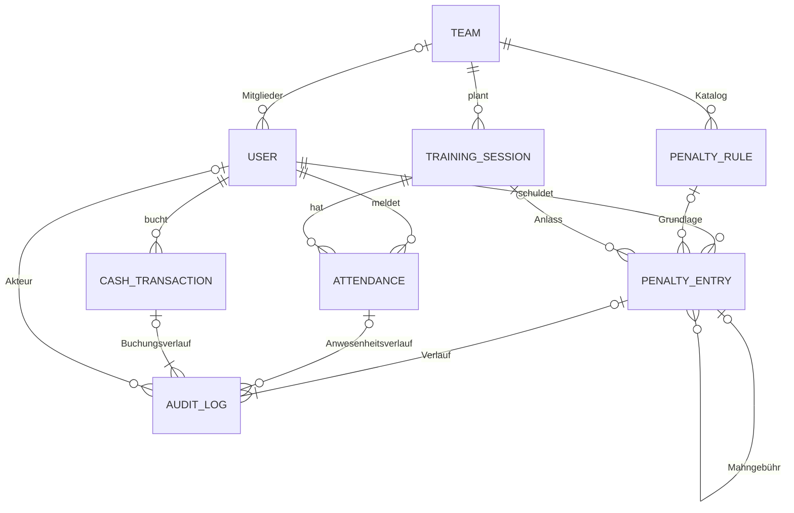
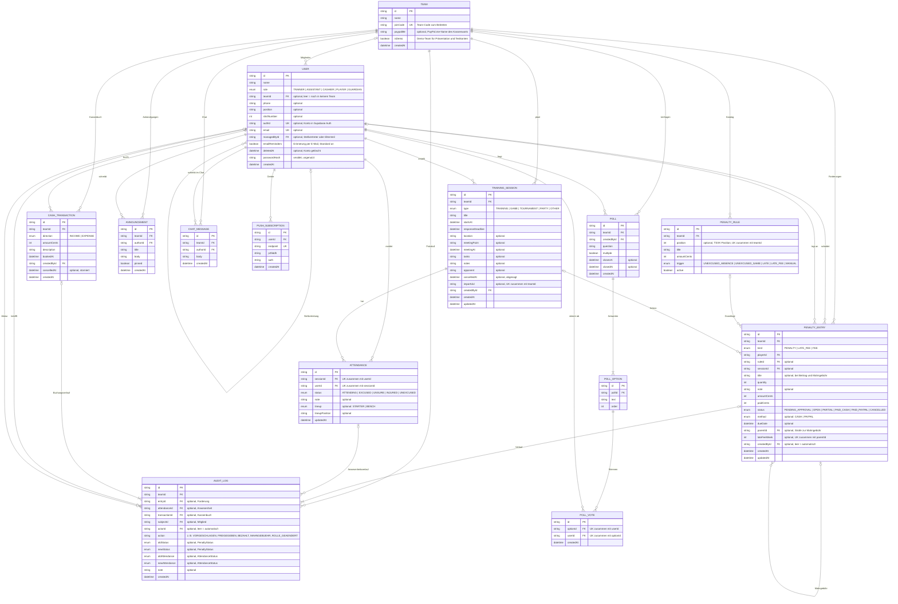

# Datenmodell: ER-Diagramm

> Stand Sprint „Features & Design“, 12.11.2026 (Teams mit Team-Code, fünf Rollen, Termine mit Typ, Kasse mit Mahngebühr, Beiträgen und Kassenbuch, Neuigkeiten, Chat, Push), entspricht exakt `prisma/schema.prisma`. PK = Primärschlüssel, FK = Fremdschlüssel, UK = eindeutig, „optional“ = darf leer sein (`?` im Schema).

## Übersicht

Die Übersicht zeigt die acht Kerntabellen mit denselben Beziehungen wie die Übersicht des [Klassendiagramms](klassendiagramm.md); Namen siehe [Namensliste](namensliste.md). Neuigkeiten, Umfragen, Chat und Push-Abos sowie die Team-Zuordnung aller Tabellen stehen in der Detailansicht.

## Detailansicht

Alle 15 Tabellen mit Spalten, Schlüsseln und Beziehungen.

## Entscheidungen im Datenmodell

| Entscheidung | Grund (Quelle) |
| --- | --- |
| Jede Fachtabelle hängt über `teamId` an genau einem `Team`, jede Abfrage filtert danach | mehrere Vereine und Mannschaften in einer App, Daten bleiben getrennt (Sprint „Features & Design“, Vorbild SpielerPlus) |
| Beitreten per `joinCode` (6 Zeichen ohne 0/O, 1/I/L), Demo-Team (`isDemo`) nicht beitretbar | einfach weiterzugeben (WhatsApp), keine Verwechslung beim Abtippen; Präsentationsdaten bleiben von echten Teams getrennt |
| Rolle am `User`, je Person ein Team | ein Konto gehört zu einer Mannschaft; Rechte je Rolle in `src/domain/permissions.ts` (REQ-SEC-01) |
| `managedById` (Stellvertretung) | Eltern oder Betreuer sagen für Jugendliche oder Mitglieder ohne Konto zu und ab |
| `emailReminders` (Standard an) | Erinnerung vor der Rückmeldefrist auch per E-Mail (#26), jede Person kann sie im Profil abschalten |
| Konto löschen setzt `deletedAt` und leert Name und Kontakt | Datenschutz; Forderungen und Protokoll bleiben anonym nachvollziehbar |
| Beträge als Integer in Cent | keine Rundungsfehler bei Teilzahlungen |
| `PENDING_APPROVAL` als eigener Status | Trainer will erst bestätigen (Interview Trainer) |
| Zahlungsstatus statt Ja/Nein, inkl. `PARTIAL` | bar, PayPal und Teilzahlung (Interview Kassenwart) |
| `CANCELLED` statt Löschen, auch bei Kassenbuch-Buchungen (`cancelledAt`) | Storno bleibt nachvollziehbar (Interview Kassenwart, Akzeptanzkriterium 3) |
| Strafen, Mahngebühren und Beiträge in einer Tabelle (`kind`) | alle Forderungen erscheinen gleich im Kassenkonto und werden gleich bezahlt |
| Mahngebühr verweist auf ihre Strafe (`parentId`), eindeutig je Strafe und Woche | automatische Mahngebühr 5 € je angefangene Woche (Strafenkatalog TSVK), keine doppelte Buchung bei gleichzeitigen Aufrufen |
| Einnahmen und Ausgaben als eigene Tabelle `CashTransaction` | Kassenstand = eingenommene Forderungen + Einnahmen − Ausgaben (Kassenwart) |
| `AuditLog` nur anlegen, nie ändern oder löschen; per Datenbank-Trigger erzwungen | wer hat wann was geändert (Interview Kassenwart), manipulationssicher (MVP-6, REQ-AUD-01) |
| jede Forderung und jede Buchung hat mindestens einen Protokolleintrag (ER: „eins oder mehr“, Klassendiagramm: `1..*`) | die Services legen Forderung bzw. Buchung und Protokolleintrag in derselben Transaktion an; die Datenbank selbst erzwingt das nicht |
| Forderung, Anwesenheit, Buchung und Mitglied mit Protokoll nicht löschbar (`onDelete: Restrict`) | Protokoll darf nicht mitgelöscht werden (REQ-AUD-01) |
| `AuditLog` betrifft genau eins: Forderung, Anwesenheit, Buchung **oder** Mitglied (CHECK `audit_log_genau_ein_bezug`) | Trainer-Änderungen an der Anwesenheit, Kassenbuch und Rollen kommen ins Protokoll, normale Spieler-Klicks nicht (Entscheidung Team 03.11.) |
| `actorId` optional | automatische Buchungen (Mahngebühr) und gelöschte Konten haben keinen Bearbeiter |
| Zahlungen ohne eigene Tabelle: `paidCents` + `method` an der Forderung, jede Zahlung als Protokolleintrag mit Betrag | reicht für bar, PayPal und Teilzahlung (MVP-5), jede Buchung bleibt nachvollziehbar |
| Passwörter nur bei Supabase Auth, `User.authId` verknüpft das Konto (ohne Fremdschlüssel, weil `auth.users` in einem anderen Schema liegt) | Registrierung, Passwort vergessen, sichere Sitzungen ohne eigene Passwort-Speicherung; im Demo-Team haben nur die drei Testkonten ein Konto |
| Row Level Security auf allen Tabellen, ohne Freigabe-Regeln (`prisma/zugriffsschutz.ts`) | Tabellen sind nicht über die REST-Schnittstelle von Supabase erreichbar; Prisma als Eigentümer ist nicht betroffen |
| eine `Attendance` je Mitglied und Termin (`@@unique`) | 1-Klick-Rückmeldung überschreibt die alte |
| `note` optional | Absage ohne Rechtfertigungsdruck (Interview Spieler) |
| `importUid` eindeutig je Team | erneuter Spielplan-Import aktualisiert Termine statt sie doppelt anzulegen |

Änderungen gegenüber der P2-Skizze: `PENDING` heißt jetzt `PENDING_APPROVAL`, `PARTIAL` und `CANCELLED` sind ergänzt, der Status `UNEXCUSED_ABSENT` aus der User Story heißt einheitlich `UNEXCUSED`.
