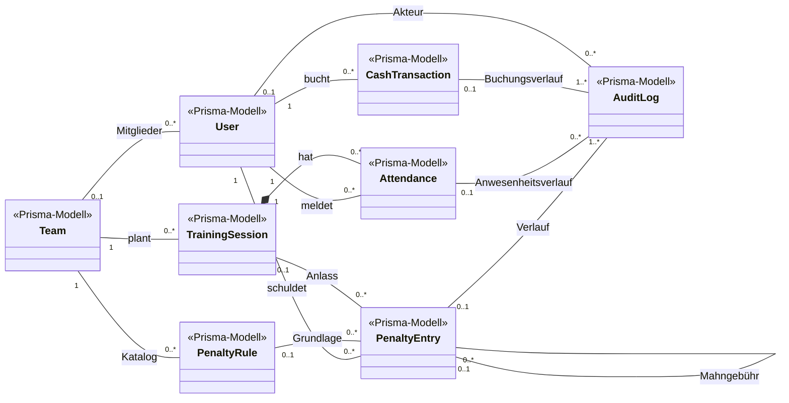
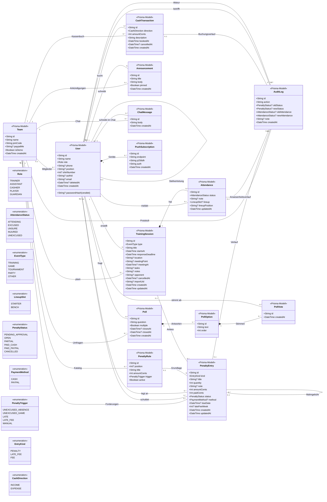

# Detailentwurf: Klassendiagramm

> Stand Sprint „Features & Design“, 12.11.2026. **Next.js kennt hier keine Klassen:** Der Code besteht aus Prisma-Modellen (reine Daten) und TypeScript-Modulen (Dateien mit Funktionen). Das Diagramm unterscheidet beides deshalb ausdrücklich:
>
> - `«Prisma-Modell»` = Modell in `prisma/schema.prisma`, Attribute = Spalten, keine Methoden. Fremdschlüssel (z. B. `playerId`) sind als Assoziationen gezeichnet, nicht als Attribute.
> - `«Modul»` = TypeScript-Datei; jede Operation ist eine exportierte Funktion. Der Klassenname ist der Codename aus dem [Komponentendiagramm](komponenten.md) (siehe [Namensliste](namensliste.md)). Parameter in geschweiften Klammern werden als ein Objekt übergeben.
> - `«enumeration»` = `enum` im Prisma-Schema. `?` = optional (darf leer sein).

## Übersicht

Die Übersicht zeigt die acht Kern-Modelle mit denselben Beziehungen wie die Übersicht des [ER-Modells](er-modell.md). Neuigkeiten, Umfragen, Chat und Push stehen in der Detailansicht Datenmodell, die Module in der Detailansicht Module und im [Komponentendiagramm](komponenten.md).

## Detailansicht Datenmodell

Alle 15 Prisma-Modelle mit Attributen, Aufzählungstypen und Beziehungen (dieselben wie im ER-Modell).

## Detailansicht Module

Alle Module mit ihren exportierten Funktionen und Abhängigkeiten. Die Prisma-Modelle aus der Detailansicht Datenmodell sind hier weggelassen; welches Modul welche Tabelle schreibt, steht in der Tabelle unter dem Diagramm.

```mermaid
classDiagram
  direction TB

  class ServerActions {
    <<Modul>>
    +login(formData) void
    +loginWithPassword(formData) void
    +registerAction(formData) void
    +resendConfirmationAction(formData) void
    +requestPasswordResetAction(formData) void
    +updatePasswordAction(formData) void
    +logout() void
    +createTeamAction(formData) void
    +joinTeamAction(formData) void
    +updateProfileAction(formData) void
    +leaveTeamAction(formData) void
    +deleteAccountAction(formData) void
    +savePushSubscription(sub) void
    +deletePushSubscription(endpoint) void
  }
  class TerminActions {
    <<Modul>>
    +respondAction(formData) void
    +createSessionAction(formData) void
    +updateSessionAction(formData) void
    +cancelSessionAction(formData) void
    +setAttendanceAction(formData) void
    +setLineupAction(formData) void
    +approveAction(formData) void
    +discardAction(formData) void
    +importCalendarAction(formData) void
  }
  class KasseActions {
    <<Modul>>
    +payAction(formData) void
    +manualPenaltyAction(formData) void
    +cancelPenaltyAction(formData) void
    +addTransactionAction(formData) void
    +cancelTransactionAction(formData) void
    +createFeesAction(formData) void
    +setPaypalAction(formData) void
    +updateRuleAction(formData) void
    +addRuleAction(formData) void
  }
  class TeamActions {
    <<Modul>>
    +changeRoleAction(formData) void
    +setGuardianAction(formData) void
    +removeMemberAction(formData) void
    +addMemberAction(formData) void
    +regenerateCodeAction(formData) void
    +renameTeamAction(formData) void
  }
  class NeuigkeitenActions {
    <<Modul>>
    +createAnnouncementAction(formData) void
    +deleteAnnouncementAction(formData) void
    +createPollAction(formData) void
    +voteAction(formData) void
    +closePollAction(formData) void
    +postMessageAction(formData) void
    +deleteMessageAction(formData) void
  }
  class Auth {
    <<Modul>>
    +isEmailLoginEnabled() Boolean
    +isDemoLoginEnabled() Boolean
    +getCurrentUser() User?
    +can(user, permission) Boolean
    +requireMember(permission?) Member
    +assertMember(permission?) Member
    +requireUser() User
    +assertUser() User
    +isInDemoTeam(user) Boolean
    +listLoginUsers() User[]
    +signIn(userId) User
    +signInWithPassword(email, password) User
    +signOut() void
    +requestPasswordReset(email, redirectTo) void
    +updatePassword(password, repeat) void
    +exchangeAuthLink(code, tokenHash, type) Boolean
    +homeFor(user) String
    +resendConfirmation(email, redirectTo) void
  }
  class Registration {
    <<Modul>>
    +MIN_PASSWORD_LENGTH = 8
    +validateRegistration(input) String?
    +validateNewPassword(password, repeat) String?
    +ensureAppUser(id, email, name, joinCode) User
    +registerUser(input, confirmRedirectTo) RegistrationResult
    +translateAuthError(message) String
  }
  class TeamService {
    <<Modul>>
    +createTeam(userId, name) Team
    +joinTeam(userId, code) Team
    +regenerateJoinCode(teamId) Team
    +renameTeam(teamId, name) Team
    +listMembers(teamId) User[]
    +listSquad(teamId) User[]
    +getTeamMember(teamId, userId) User
    +changeRole(teamId, actorId, userId, role) void
    +removeMember(teamId, actorId, userId) void
    +leaveTeam(userId) void
    +addMemberWithoutAccount(teamId, actorId, name, managedById?) User
    +setGuardian(teamId, userId, managedById) void
    +updateProfile(userId, data) void
    +deleteAccount(userId) void
    +getTeamName(teamId) String
    +listRespondents(user) User[]
  }
  class AttendanceService {
    <<Modul>>
    +EVENT_TYPES EventType[]
    +getSession(teamId, sessionId) TrainingSession
    +respond(teamId, actor, memberId, sessionId, status, note?) void
    +setByTrainer(teamId, trainerId, sessionId, playerId, status) void
    +createSession(teamId, trainerId, SessionInput) TrainingSession
    +updateSession(teamId, sessionId, SessionInput) TrainingSession
    +setCancelled(teamId, sessionId, cancelled) TrainingSession
    +listUpcoming(teamId, limit?, type?) TrainingSession[]
    +listPast(teamId, limit, type?) TrainingSession[]
    +listSessions(teamId, type?) TrainingSession[]
    +getAttendanceList(teamId, sessionId) AttendanceList
    +setLineup(teamId, sessionId, playerId, lineup, lineupPosition?) void
    +importCalendar(teamId, trainerId, icsText, type, toBerlin) ImportResult
    +listMissingResponses(teamId, userIds, hours) TrainingSession[]
    +countResponses(attendances, squadSize) ResponseCount
  }
  class PenaltyEngine {
    <<Modul>>
    +syncPenaltyForAttendance(tx, teamId, sessionId, eventType, playerId, status, actorId) void
    +createManualPenalty(teamId, actorId, directlyOpen, playerId, ruleId, quantity, sessionId?, note?) PenaltyEntry
    +approvePenalty(teamId, entryId, actorId) void
    +discardPenalty(teamId, entryId, actorId) void
    +cancelPenalty(teamId, entryId, actorId, note?) void
    +listPenaltiesForPlayer(teamId, playerId) PenaltyEntry[]
    +getPlayerAccount(teamId, playerId) PlayerAccount
    +listPendingForSession(teamId, sessionId) PenaltyEntry[]
    +listPendingForTeam(teamId) PenaltyEntry[]
    +listRules(teamId) PenaltyRule[]
    +updateRule(teamId, ruleId, title, amountCents, active) PenaltyRule
    +addRule(teamId, title, amountCents) PenaltyRule
  }
  class PaymentService {
    <<Modul>>
    +recordPayment(teamId, entryId, actorId, method, amountCents?) void
    +applyLateFees(teamId, now) Int
    +getTeamCash(teamId, now) TeamCash
    +addTransaction(teamId, actorId, direction, amountCents, description, bookedAt?) CashTransaction
    +cancelTransaction(teamId, actorId, transactionId) void
    +createFees(teamId, actorId, title, amountCents, playerIds, dueDate?) Int
    +setPaypalMe(teamId, input) Team
    +paypalLinkFor(team, cents) String?
  }
  class AuditService {
    <<Modul>>
    +AUDIT_ACTION_LABEL
    +logPenaltyChange(tx, teamId, entryId, actorId, action, oldStatus, newStatus, note?) void
    +logAttendanceChange(tx, teamId, attendanceId, actorId, oldAttendance, newAttendance) void
    +logTransaction(tx, teamId, transactionId, actorId, action, note?) void
    +logMemberChange(tx, teamId, subjectId, actorId, action, note?) void
    +listAuditLog(teamId, limit) AuditLog[]
  }
  class NewsService {
    <<Modul>>
    +createAnnouncement(teamId, authorId, title, body, pinned) Announcement
    +listAnnouncements(teamId, take) Announcement[]
    +deleteAnnouncement(teamId, id, userId, isTrainer) void
    +createPoll(teamId, createdById, question, options, multiple, closesAt?) Poll
    +isPollOpen(poll, now) Boolean
    +listPolls(teamId, take) Poll[]
    +vote(teamId, userId, optionId) void
    +closePoll(teamId, pollId) void
    +postMessage(teamId, authorId, body) ChatMessage
    +listMessages(teamId, take) ChatMessage[]
    +deleteMessage(teamId, id, userId) void
  }
  class StatsService {
    <<Modul>>
    +getParticipation(teamId, type?) Participation[]
  }
  class PushService {
    <<Modul>>
    +pushPublicKey() String?
    +saveSubscription(userId, sub) void
    +removeSubscription(userId, endpoint) void
    +hasSubscription(userId) Boolean
    +notifyUsers(userIds, message) void
    +notifyTeam(teamId, message, opts) void
    +sendDeadlineReminders(now) Int
  }
  class Permissions {
    <<Modul>>
    +can(role, permission) Boolean
    +SQUAD_ROLES Role[]
    +mayRespondFor(actor, member) Boolean
    +roleChangeProblem(target, newRole, trainerCount) String?
    +TEST_ACCOUNT_DOMAIN = "@squadhq.test"
    +isTestAccountEmail(email) Boolean
    +JOIN_CODE_ALPHABET
    +JOIN_CODE_LENGTH = 6
    +generateJoinCode(random) String
    +normalizeJoinCode(input) String
  }
  class Penalties {
    <<Modul>>
    +DUE_DAYS = 7
    +PLAYER_CHOICES AttendanceStatus[]
    +absenceTriggerFor(type) PenaltyTrigger?
    +suggestRuleForAttendance(status, rules, eventType) PenaltyRule?
    +manualPenaltyAmount(rule, quantity) Int
    +isOutstanding(status) Boolean
    +openAmount(entry) Int
    +balance(entries) Int
    +dueDateFrom(approvedAt) DateTime
    +LATE_FEE_CENTS_PER_WEEK = 500
    +applyPayment(entry, method, amountCents?) PaymentResult
    +isOverdue(entry, now) Boolean
    +weeksOverdue(entry, now) Int
    +missingLateFeeWeeks(entry, existingWeeks, now) Int[]
    +cashBalance(paidCents, transactions) CashBalance
    +normalizePaypalMe(input) String?
    +paypalMeUrl(name, cents) String
    +participationRate(statuses) Rate
  }
  class Ics {
    <<Modul>>
    +parseIcs(text, toBerlin) ImportedEvent[]
  }

  ServerActions ..> Auth : nutzt
  ServerActions ..> Registration : nutzt
  ServerActions ..> TeamService : nutzt
  ServerActions ..> PushService : nutzt
  TerminActions ..> Auth : nutzt
  TerminActions ..> AttendanceService : nutzt
  TerminActions ..> PenaltyEngine : nutzt
  TerminActions ..> PushService : nutzt
  KasseActions ..> Auth : nutzt
  KasseActions ..> PenaltyEngine : nutzt
  KasseActions ..> PaymentService : nutzt
  KasseActions ..> PushService : nutzt
  TeamActions ..> Auth : nutzt
  TeamActions ..> TeamService : nutzt
  NeuigkeitenActions ..> Auth : nutzt
  NeuigkeitenActions ..> NewsService : nutzt
  NeuigkeitenActions ..> PushService : nutzt
  Auth ..> Registration : nutzt
  Auth ..> Permissions : nutzt
  Registration ..> TeamService : nutzt
  AttendanceService ..> PenaltyEngine : nutzt
  AttendanceService ..> AuditService : nutzt
  AttendanceService ..> TeamService : nutzt
  AttendanceService ..> Penalties : nutzt
  AttendanceService ..> Permissions : nutzt
  AttendanceService ..> Ics : nutzt
  PenaltyEngine ..> PaymentService : nutzt
  PenaltyEngine ..> AuditService : nutzt
  PenaltyEngine ..> Penalties : nutzt
  PenaltyEngine ..> Permissions : nutzt
  PaymentService ..> AuditService : nutzt
  PaymentService ..> Penalties : nutzt
  PaymentService ..> Permissions : nutzt
  TeamService ..> AuditService : nutzt
  TeamService ..> Permissions : nutzt
  StatsService ..> TeamService : nutzt
  StatsService ..> Penalties : nutzt
  PushService ..> Permissions : nutzt
```

Hinweise zum Diagramm:

- Dateien der Module: `ServerActions` = `src/app/actions.ts` (Anmeldung, Team gründen/beitreten, Profil, Push), `TerminActions` = `src/app/termine/actions.ts`, `KasseActions` = `src/app/kasse/actions.ts`, `TeamActions` = `src/app/team/actions.ts`, `NeuigkeitenActions` = `src/app/neuigkeiten/actions.ts`; alle fünf bilden zusammen die Komponente „Eingaben verarbeiten“. `Auth` = `src/lib/auth.ts`, `Registration` = `src/lib/registration.ts`, Services = `src/services/…`, `Permissions` = `src/domain/permissions.ts` (Rechte-Tabelle, REQ-SEC-01), `Penalties` = `src/domain/penalties.ts` (Regelverwaltung), `Ics` = `src/domain/ics.ts` (Spielplan-Import); die drei Fachlogik-Module sind reine Funktionen ohne Datenbank.
- Welche Tabellen die Module schreiben: TeamService → `Team`, `User`, `AuditLog`; AttendanceService → `TrainingSession`, `Attendance`, `AuditLog`; PenaltyEngine → `PenaltyEntry`, `PenaltyRule`, `AuditLog`; PaymentService → `PenaltyEntry`, `CashTransaction`, `Team.paypalMe`, `AuditLog`; NewsService → `Announcement`, `Poll`, `PollOption`, `PollVote`, `ChatMessage`; PushService → `PushSubscription`; Registration → `User`; AuditService → `AuditLog` (nur anlegen).
- Die Abhängigkeiten (gestrichelte Pfeile) zeigen nur nach unten, genau wie im Komponentendiagramm: Server Actions → Auth/Services → Fachlogik. Innerhalb der Services gibt es keine Kreise. Die Seiten (Präsentation) sind keine Module mit Operationen und stehen deshalb nur im Komponentendiagramm.
- Ergebnistypen: `Member` = `User` mit Team (angemeldet und in einem Team). `AttendanceList` = Termin und je Mitglied des Kaders seine Rückmeldung (oder keine). `PlayerAccount` = Saldo in Cent und sichtbare Forderungen. `TeamCash` = offene (mit überfällig) und bezahlte Forderungen, Summen, Salden je Mitglied, Kassenbuch und Kassenstand. `PaymentResult` = neuer Status, bezahlter und gebuchter Betrag. `CashBalance` = Einnahmen, Ausgaben, Kassenstand. `ImportResult` = angelegt, aktualisiert, übersprungen. `RegistrationResult` = neuer Nutzer und ob Supabase noch eine E-Mail-Bestätigung verlangt.
- `User.passwordHash` ist seit dem Umstieg auf Supabase Auth (10.11.2026) veraltet und wird nicht mehr benutzt.
- Komposition (gefüllte Raute): Wird ein Termin gelöscht, werden seine Rückmeldungen mitgelöscht; ebenso Antworten und Stimmen einer Umfrage und die Push-Abos eines Mitglieds (`onDelete: Cascade` im Schema).
- `PenaltyEntry`, `CashTransaction` und `AuditLog` sind bewusst nur assoziiert, nicht komponiert: Das Protokoll ist manipulationssicher (REQ-AUD-01). Eine Forderung oder Buchung mit Protokoll lässt sich nicht löschen (`onDelete: Restrict`), nur stornieren; Protokolleinträge selbst lehnt die Datenbank beim Ändern und Löschen ab (Trigger, `prisma/auditLogSchutz.ts`).
- Ein `AuditLog`-Eintrag betrifft genau eine Sache: eine Forderung (`Verlauf`), eine vom Trainer gesetzte Anwesenheit (`Anwesenheitsverlauf`), eine Kassenbuch-Buchung (`Buchungsverlauf`) **oder** ein Mitglied (`betrifft`, z. B. Rolle geändert). Deshalb `0..1` auf allen vier Seiten; die Datenbank erzwingt „genau eins“ per CHECK-Bedingung. Normale Spieler-Rückmeldungen werden nicht protokolliert.
- `1..*` bei `Verlauf` und `Buchungsverlauf`: Die Datenbank erlaubt auch 0 Einträge, aber die Services legen jede Forderung und jede Buchung zusammen mit ihrem ersten Protokolleintrag in derselben Transaktion an.
- `Akteur` ist `0..1`: Die automatische Mahngebühr hat keinen Bearbeiter (im Protokoll „automatisch“).
