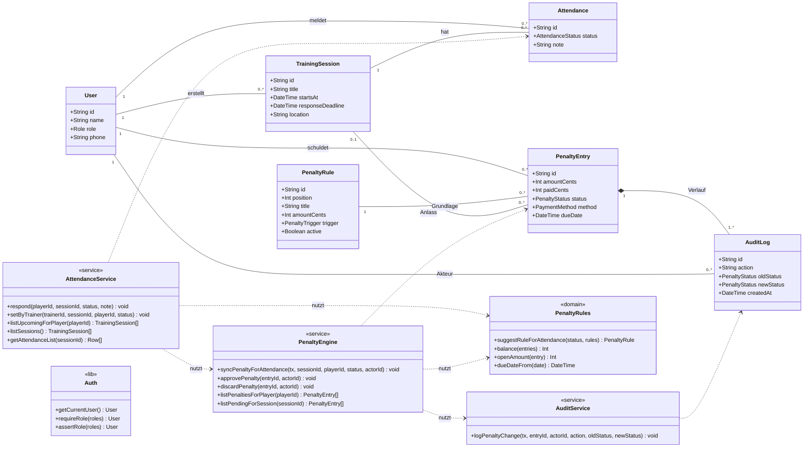

# Detailentwurf: Klassendiagramm

> Entwurf für P3. Next.js-Services sind als Module mit Funktionen umgesetzt; im Diagramm als Klassen mit statischen Operationen (`<<service>>`) dargestellt. Entitäten entsprechen den Prisma-Modellen.

Aufzählungstypen: `Role {TRAINER, CASHIER, PLAYER}`, `AttendanceStatus {ATTENDING, EXCUSED, UNSURE, UNEXCUSED}`, `PenaltyStatus {PENDING_APPROVAL, OPEN, PARTIAL, PAID_CASH, PAID_PAYPAL, CANCELLED}`, `PaymentMethod {CASH, PAYPAL}`, `PenaltyTrigger {UNEXCUSED_ABSENCE, LATE, MANUAL}`.
