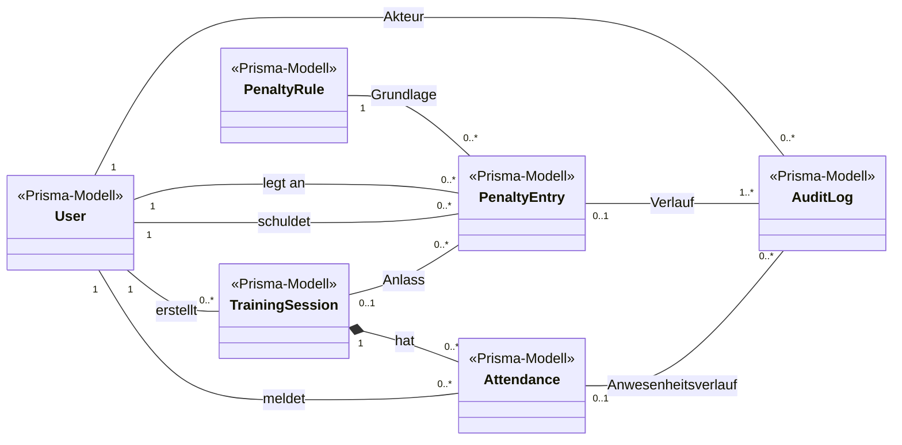
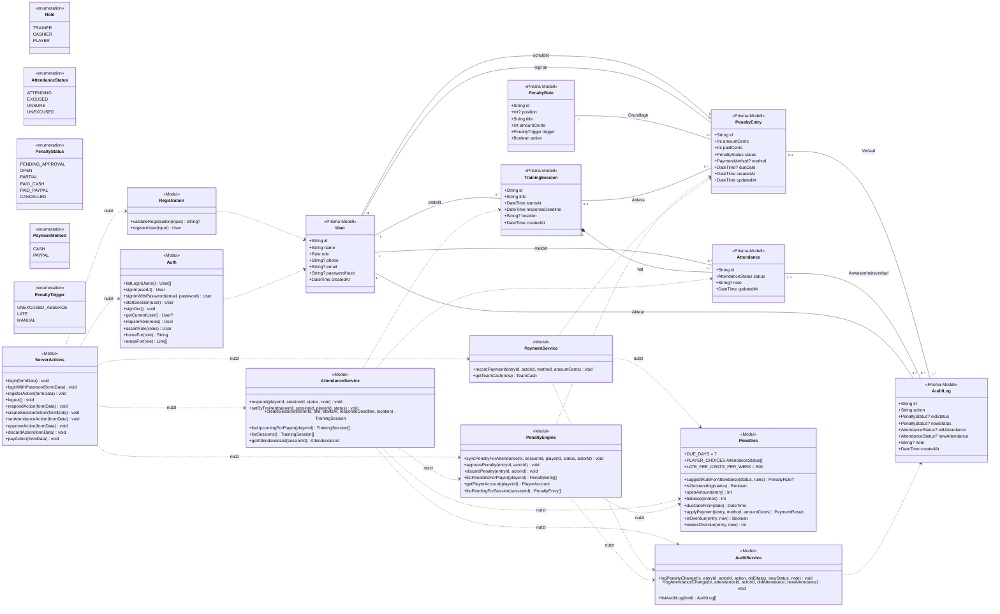

# Detailentwurf: Klassendiagramm

> Überarbeitet nach dem P3-Feedback (09.11.2026). **Next.js kennt hier keine Klassen:** Der Code besteht aus Prisma-Modellen (reine Daten) und TypeScript-Modulen (Dateien mit Funktionen). Das Diagramm unterscheidet beides deshalb ausdrücklich:
>
> - `«Prisma-Modell»` = Modell in `prisma/schema.prisma`, Attribute = Spalten, keine Methoden. Fremdschlüssel (z. B. `playerId`) sind als Assoziationen gezeichnet, nicht als Attribute.
> - `«Modul»` = TypeScript-Datei; jede Operation ist eine exportierte Funktion. Der Klassenname ist der Codename aus dem [Komponentendiagramm](komponenten.md) (siehe [Namensliste](namensliste.md)).
> - `«enumeration»` = `enum` im Prisma-Schema. `?` = optional (darf leer sein).

## Übersicht

Die Übersicht zeigt die sechs Prisma-Modelle mit denselben zehn Beziehungen wie die Übersicht des [ER-Modells](er-modell.md); die Module stehen in der Detailansicht und im [Komponentendiagramm](komponenten.md).

## Detailansicht

Alle Attribute, Operationen, Aufzählungstypen und Beziehungen.

Hinweise zum Diagramm:

- Dateien der Module: `ServerActions` = `src/app/actions.ts`, `Auth` = `src/lib/auth.ts`, `Registration` = `src/lib/registration.ts` (Passwort-Hash mit `src/lib/password.ts`), `AttendanceService`, `PenaltyEngine`, `AuditService`, `PaymentService` = `src/services/…`, `Penalties` = `src/domain/penalties.ts` (Regelverwaltung, reine Funktionen ohne Datenbank).
- Die Abhängigkeiten (gestrichelte Pfeile) zeigen nur nach unten, genau wie im Komponentendiagramm: Server Actions → Services → Regelverwaltung. Die Seiten (Präsentation) sind keine Module mit Operationen und stehen deshalb nur im Komponentendiagramm.
- `AttendanceList` ist das Ergebnis von `getAttendanceList`: das Training und je Spieler des Kaders seine Rückmeldung (oder keine). `PlayerAccount` ist das Ergebnis von `getPlayerAccount`: Saldo in Cent und die sichtbaren Strafen. `TeamCash` ist das Ergebnis von `getTeamCash`: offene Strafen (mit überfällig und Mahngebühr), bezahlte Strafen, Summen und offene Beträge je Spieler. `PaymentResult` ist der neue Zustand nach einer Zahlung (Status, bezahlter Betrag).
- Komposition (gefüllte Raute): Wird ein Training gelöscht, werden seine Rückmeldungen mitgelöscht (`onDelete: Cascade` im Schema).
- `PenaltyEntry` und `AuditLog` sind bewusst nur assoziiert, nicht komponiert: Das Protokoll ist manipulationssicher (REQ-AUD-01). Eine Strafe mit Protokoll lässt sich nicht löschen (`onDelete: Restrict`), nur stornieren (`CANCELLED`); Protokolleinträge selbst lehnt die Datenbank beim Ändern und Löschen ab (Trigger, `prisma/auditLogSchutz.ts`).
- Ein `AuditLog`-Eintrag betrifft genau eine Sache: eine Strafe (`Verlauf`) **oder** eine vom Trainer gesetzte Anwesenheit (`Anwesenheitsverlauf`). Deshalb `0..1` auf beiden Seiten; die Datenbank erzwingt „genau eins von beiden“ per CHECK-Bedingung (`prisma/auditLogSchutz.ts`). Normale Spieler-Rückmeldungen werden nicht protokolliert.
- `1..*` bei `AuditLog`: Die Datenbank erlaubt auch 0 Einträge, aber die PenaltyEngine legt jede Strafe zusammen mit dem Protokolleintrag `VORGESCHLAGEN` in derselben Transaktion an. Deshalb hat jede Strafe mindestens einen Eintrag.
