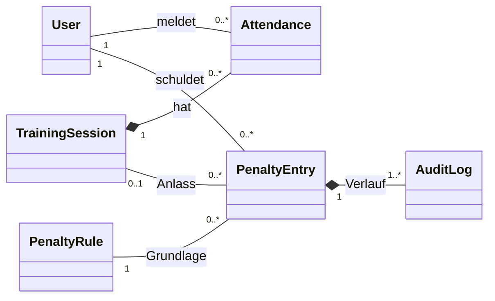
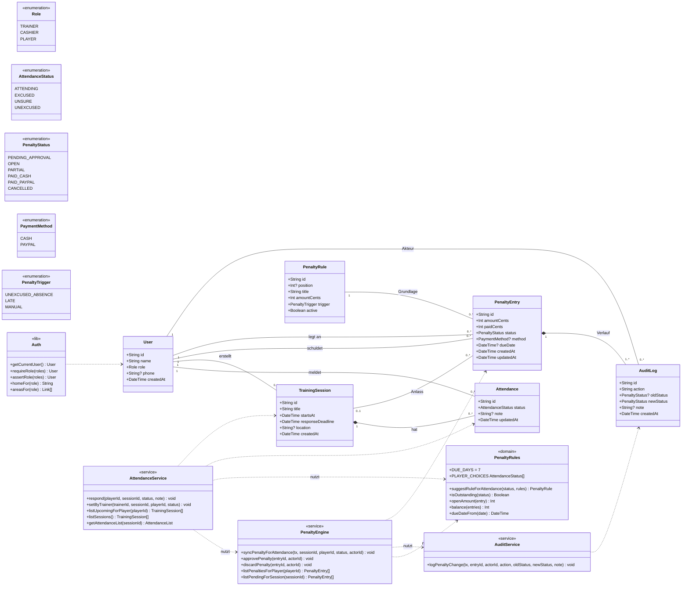

# Detailentwurf: Klassendiagramm

> Entwurf für P3. Next.js-Services sind als Module mit Funktionen umgesetzt; im Diagramm als Klassen mit statischen Operationen (`<<service>>`) dargestellt. Entitäten entsprechen den Prisma-Modellen in `prisma/schema.prisma`; Fremdschlüssel (z. B. `playerId`) sind als Assoziationen gezeichnet, nicht als Attribute. `?` = optional (darf leer sein).

## Übersicht

Die Übersicht zeigt nur die Fachklassen und ihre Beziehungen; die Services stehen in der Detailansicht und im [Komponentendiagramm](komponenten.md).

## Detailansicht

Alle Attribute, Operationen, Aufzählungstypen und Beziehungen.

Hinweise zum Diagramm:

- Datei der Klasse `PenaltyRules` ist `src/domain/penalties.ts` (reine Funktionen ohne Datenbank), `Auth` ist `src/lib/auth.ts`.
- `AttendanceList` ist das Ergebnis von `getAttendanceList`: das Training und je Spieler des Kaders seine Rückmeldung (oder keine).
- Komposition (gefüllte Raute): Wird ein Training gelöscht, werden seine Rückmeldungen mitgelöscht; wird eine Strafe gelöscht, auch ihr Protokoll (`onDelete: Cascade` im Schema).
- `1..*` bei `AuditLog`: Die Datenbank erlaubt auch 0 Einträge, aber die PenaltyEngine legt jede Strafe zusammen mit dem Protokolleintrag `VORGESCHLAGEN` in derselben Transaktion an. Deshalb hat jede Strafe mindestens einen Eintrag.
