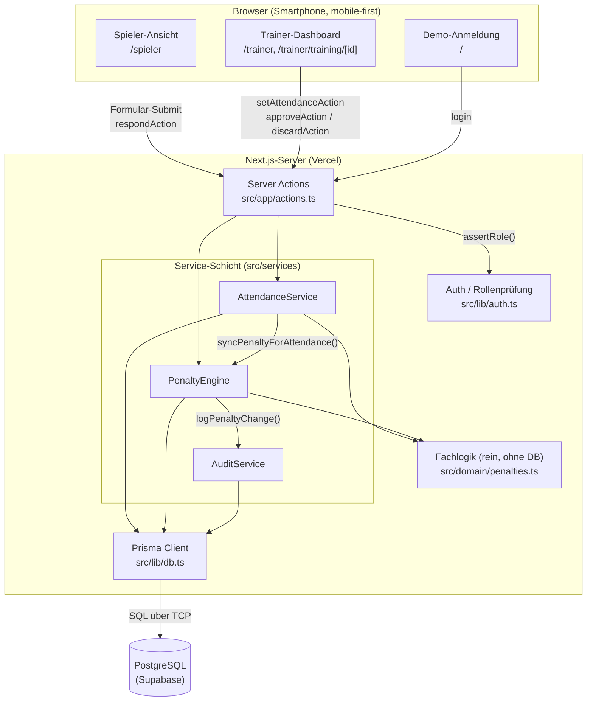

# Komponentenmodell (High-Level-Struktur)

> Entwurf für P3. Verantwortlich: Architektur & Entwurf. Notation: UML-Komponentendiagramm in Mermaid (rendert direkt auf GitHub).

## Komponenten und Schnittstellen

| Komponente | Verantwortung | Angebotene Schnittstelle |
| --- | --- | --- |
| Spieler-Ansicht | Rückmeldung zu Trainings, eigenes Kassenkonto | – (UI) |
| Trainer-Dashboard | Trainingsübersicht, Anwesenheit bestätigen, Strafvorschläge freigeben | – (UI) |
| Server Actions | Einstiegspunkt aller Schreibzugriffe, Rollenprüfung, Revalidierung | `login`, `logout`, `respondAction`, `setAttendanceAction`, `approveAction`, `discardAction` |
| Auth | aktuelle Person ermitteln, Rollen prüfen (REQ-SEC-01) | `getCurrentUser()`, `requireRole()`, `assertRole()` |
| AttendanceService | Rückmeldungen speichern, Anwesenheitsliste liefern | `respond()`, `setByTrainer()`, `listUpcomingForPlayer()`, `listSessions()`, `getAttendanceList()` |
| PenaltyEngine | Strafvorschlag nach Katalog, Freigabe, Verwerfen, Storno | `syncPenaltyForAttendance()`, `approvePenalty()`, `discardPenalty()`, `listPenaltiesForPlayer()`, `listPendingForSession()` |
| AuditService | unveränderliches Protokoll jeder Statusänderung | `logPenaltyChange()` |
| Fachlogik | reine Regeln ohne Seiteneffekte, unit-getestet | `suggestRuleForAttendance()`, `balance()`, `openAmount()`, `dueDateFrom()` |
| Prisma Client | Datenzugriff, Transaktionen | generiert aus `prisma/schema.prisma` |
