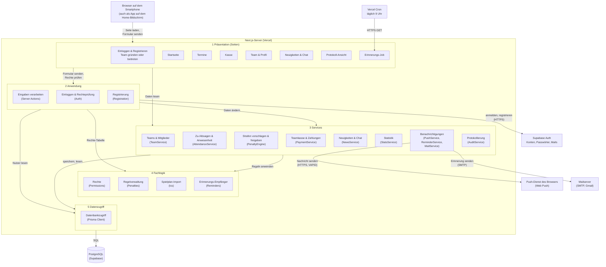

# Komponentenmodell und Schichtenarchitektur

> Stand Sprint „Features & Design“, 12.11.2026. Die Kästen tragen konkrete Namen dessen, was die Komponente tut (seit dem P3-Feedback). Komponentendiagramm und Schichtenarchitektur sind **ein und dasselbe Bild**: Die Rahmen sind die fünf Schichten, die Kästen darin die Komponenten. Alle Namen stehen in der [Namensliste](namensliste.md) und sind in allen Diagrammen gleich.
>
> **Legende:** Rahmen = Schicht (bzw. Knoten), Kasten = Komponente mit Codename in Klammern, Zylinder = Datenbank, Pfeil = Aufruf in Pfeilrichtung (nur von oben nach unten), Pfeilbeschriftung = genutzte Schnittstelle. Alle Komponenten sind im Code, es gibt keine geplanten Kästen.

## Übersicht

## Detailansicht

Dieselben Schichten und Komponenten mit allen Aufrufen und den wichtigsten genutzten Funktionen. Die vollständigen Schnittstellen stehen in der Tabelle darunter und im [Klassendiagramm](klassendiagramm.md).

```mermaid
flowchart TB
  B["Browser (Smartphone, mobile-first)<br/>zeigt HTML, sendet Formulare,<br/>Service Worker public/sw.js"]
  CRON["Vercel Cron (vercel.json)"]

  subgraph Server["Next.js-Server (Vercel)"]
    direction TB
    subgraph S1["1 Präsentation (src/app)"]
      P_LOGIN["Einloggen & Registrieren<br/>/, /registrieren, /bestaetigen,<br/>/passwort-…, /auth/callback, /willkommen"]
      P_START["Startseite<br/>/start"]
      P_TER["Termine<br/>/termine, /termine/neu, /termine/[id],<br/>/termine/[id]/bearbeiten, /termine/import"]
      P_KASSE["Kasse<br/>/kasse, /kasse/strafe, /kasse/katalog,<br/>/kasse/beitrag, /kasse/buchung"]
      P_TEAM["Team & Profil<br/>/team, /team/statistik, /profil"]
      P_NEWS["Neuigkeiten & Chat<br/>/neuigkeiten, /neuigkeiten/umfrage, /chat"]
      P_LOG["Protokoll-Ansicht<br/>/protokoll"]
      P_JOB["Erinnerungs-Job<br/>/api/cron/erinnerungen"]
    end
    subgraph S2["2 Anwendung"]
      ACT["Eingaben verarbeiten<br/>Server Actions<br/>src/app/**/actions.ts"]
      AUTH["Einloggen & Rechteprüfung<br/>Auth, src/lib/auth.ts"]
      REG["Registrierung<br/>Registration, src/lib/registration.ts"]
    end
    subgraph S3["3 Services (src/services)"]
      TEAM["Teams & Mitglieder<br/>TeamService"]
      ATT["Zu-/Absagen & Anwesenheit<br/>AttendanceService"]
      PEN["Strafen vorschlagen & freigeben<br/>PenaltyEngine"]
      PAY["Teamkasse & Zahlungen<br/>PaymentService"]
      NEWS["Neuigkeiten & Chat<br/>NewsService"]
      STATS["Statistik<br/>StatsService"]
      PUSH["Benachrichtigungen<br/>PushService, ReminderService,<br/>MailService"]
      AUD["Protokollierung<br/>AuditService"]
    end
    subgraph S4["4 Fachlogik (src/domain)"]
      PERM["Rechte<br/>Permissions, permissions.ts"]
      RULES["Regelverwaltung<br/>Penalties, penalties.ts"]
      ICS["Spielplan-Import<br/>Ics, ics.ts"]
      REM["Erinnerungs-Empfänger<br/>Reminders, reminders.ts"]
    end
    subgraph S5["5 Datenzugriff"]
      ORM["Datenbankzugriff<br/>Prisma Client, src/lib/db.ts"]
    end
  end

  DB[("PostgreSQL<br/>(Supabase)")]
  SA["Supabase Auth<br/>(@supabase/ssr, src/lib/supabase.ts)"]
  WP["Push-Dienst des Browsers<br/>(web-push)"]
  MAIL["Mailserver<br/>(SMTP über nodemailer, z. B. Gmail)"]

  B -- "HTTPS GET (Seite laden)" --> S1
  B -- "HTTPS POST (Formular)" --> ACT
  CRON -- "GET mit CRON_SECRET" --> P_JOB

  S1 -- "requireMember(recht)<br/>requireUser(), can()" --> AUTH
  P_LOGIN -- "getCurrentUser()<br/>exchangeAuthLink()" --> AUTH
  P_START -- "listUpcoming(), countResponses()<br/>listMissingResponses()" --> ATT
  P_START -- "getPlayerAccount()<br/>listPendingForTeam()" --> PEN
  P_START -- "listAnnouncements(), listPolls()" --> NEWS
  P_START -- "listRespondents(), listSquad()" --> TEAM
  P_TER -- "listUpcoming(), listPast(), countResponses()<br/>getAttendanceList(), getSession()" --> ATT
  P_TER -- "listPendingForSession()" --> PEN
  P_TER -- "listRespondents(), listSquad()" --> TEAM
  P_KASSE -- "getTeamCash(), paypalLinkFor()" --> PAY
  P_KASSE -- "getPlayerAccount(), listRules()<br/>listPendingForTeam()" --> PEN
  P_KASSE -- "listRespondents(), listSquad()" --> TEAM
  P_KASSE -- "listPast()" --> ATT
  P_TEAM -- "listMembers()" --> TEAM
  P_TEAM -- "getParticipation()" --> STATS
  P_TEAM -- "pushPublicKey(), mailConfigured()" --> PUSH
  P_NEWS -- "listAnnouncements()<br/>listPolls(), listMessages()" --> NEWS
  P_LOG -- "listAuditLog()" --> AUD
  P_JOB -- "sendDeadlineReminders()" --> PUSH

  ACT -- "assertMember(recht)<br/>signInWithPassword(), signOut()<br/>updatePassword(), …" --> AUTH
  ACT -- "registerUser()" --> REG
  ACT -- "createTeam(), joinTeam(), changeRole()<br/>setEmailReminders(), deleteAccount(), …" --> TEAM
  ACT -- "respond(), setByTrainer(), createSession()<br/>setLineup(), importCalendar(), …" --> ATT
  ACT -- "approvePenalty(), discardPenalty()<br/>createManualPenalty(), cancelPenalty(), …" --> PEN
  ACT -- "recordPayment(), addTransaction()<br/>createFees(), setPaypalMe(), …" --> PAY
  ACT -- "createAnnouncement(), createPoll()<br/>vote(), postMessage(), …" --> NEWS
  ACT -- "notifyTeam(), notifyUsers()<br/>saveSubscription()" --> PUSH
  AUTH -- "ensureAppUser()" --> REG
  REG -- "joinTeam()" --> TEAM
  AUTH -- "can()" --> PERM

  ATT -- "syncPenaltyForAttendance()" --> PEN
  ATT -- "listSquad()" --> TEAM
  STATS -- "listSquad()" --> TEAM
  PEN -- "applyLateFees()" --> PAY
  TEAM -- "logMemberChange()" --> AUD
  ATT -- "logAttendanceChange()" --> AUD
  PEN -- "logPenaltyChange()" --> AUD
  PAY -- "logPenaltyChange()<br/>logTransaction()" --> AUD

  TEAM -- "generateJoinCode()<br/>roleChangeProblem()" --> PERM
  ATT -- "mayRespondFor()" --> PERM
  PUSH -- "SQUAD_ROLES" --> PERM
  PUSH -- "reminderMails()" --> REM
  REM -- "isTestAccountEmail()" --> PERM
  ATT -- "PLAYER_CHOICES" --> RULES
  ATT -- "parseIcs()" --> ICS
  PEN -- "suggestRuleForAttendance()<br/>dueDateFrom(), balance()" --> RULES
  PAY -- "applyPayment(), missingLateFeeWeeks()<br/>cashBalance(), paypalMeUrl()" --> RULES
  STATS -- "participationRate()" --> RULES

  S3 --> ORM
  AUTH --> ORM
  REG --> ORM
  ORM -- "SQL über TCP" --> DB
  AUTH -- "signInWithPassword(), getUser()<br/>resetPasswordForEmail(), updateUser()" --> SA
  REG -- "signUp()" --> SA
  PUSH -- "sendNotification()" --> WP
  PUSH -- "sendMail()" --> MAIL
  WP -- "Benachrichtigung" --> B
  MAIL -- "Erinnerungs-Mail" --> B
```

Lesend greifen die Seiten über die Services zu, schreibend nur über die Server Actions. Alle Pfeile zeigen nach unten (der Push-Dienst und der Mailserver liefern Benachrichtigungen außerhalb des Servers an Browser bzw. Postfach); eine Schicht darf eine tiefere überspringen (gelockerte Schichtenarchitektur), aber nie nach oben zeigen. Die Seiten kennen weder die Datenbank noch die Fachlogik direkt (per ESLint geprüft). Jede Seite und jede Server Action prüft zuerst mit `requireMember(recht)` bzw. `assertMember(recht)`, ob die Person im Team ist und das Recht hat (Rechte-Tabelle in `src/domain/permissions.ts`). Begründung siehe [Architekturbegründung](architekturbegruendung.md).

## Komponenten und Schnittstellen

| Schicht | Komponente (Codename) | Verantwortung | Angebotene Schnittstelle |
| --- | --- | --- | --- |
| 1 Präsentation | Einloggen & Registrieren (`/`, `/registrieren`, `/bestaetigen`, `/passwort-vergessen`, `/passwort-neu`, `/auth/callback`, `/willkommen`) | mit E-Mail und Passwort anmelden, Konto anlegen (optional mit Team-Code), Bestätigungsmail erneut senden, Passwort zurücksetzen, Team gründen oder beitreten; zum Ausprobieren Testkonten im Demo-Team | – (UI) |
| 1 Präsentation | Startseite (`/start`) | nächste Termine mit Zusage, fehlende Rückmeldungen, offene Freigaben, Kassenkonto, Neuigkeiten | – (UI) |
| 1 Präsentation | Termine (`/termine`, `/termine/neu`, `/termine/[id]`, `/termine/[id]/bearbeiten`, `/termine/import`) | Termine je Typ, zu- und absagen (auch für Stellvertretene), Termin anlegen, bearbeiten, absagen, Anwesenheit bestätigen, Strafvorschläge freigeben, Aufstellung, Spielplan-Import | – (UI) |
| 1 Präsentation | Kasse (`/kasse`, `/kasse/strafe`, `/kasse/katalog`, `/kasse/beitrag`, `/kasse/buchung`) | eigenes Kassenkonto mit PayPal-Link; Freigaben; offene und bezahlte Forderungen, Kassenbuch und Einstellungen (Kassenwart); Strafe vergeben, Katalog pflegen, Beiträge, Einnahmen/Ausgaben | – (UI) |
| 1 Präsentation | Team & Profil (`/team`, `/team/statistik`, `/profil`) | Mitglieder, Team-Code teilen, Rollen, Stellvertreter, Mitglieder ohne Konto; Beteiligungsstatistik; eigenes Profil, Passwort, Push, E-Mail-Erinnerung an/aus, Team verlassen, Konto löschen | – (UI) |
| 1 Präsentation | Neuigkeiten & Chat (`/neuigkeiten`, `/neuigkeiten/umfrage`, `/chat`) | Ankündigungen, Umfragen mit Abstimmung, Team-Chat | – (UI) |
| 1 Präsentation | Protokoll-Ansicht (`/protokoll`, MVP-6) | Audit-Log lesen (Trainer und Kassenwart) | – (UI) |
| 1 Präsentation | Erinnerungs-Job (`/api/cron/erinnerungen`) | täglich von Vercel Cron aufgerufen, geschützt mit `CRON_SECRET`; erinnert per Push und E-Mail | `GET` |
| 2 Anwendung | Eingaben verarbeiten (Server Actions in `src/app/actions.ts`, `termine/`, `kasse/`, `team/`, `neuigkeiten/actions.ts`) | Einstieg aller Schreibzugriffe: Recht prüfen, Service aufrufen, ggf. Push senden, Seite aktualisieren oder mit Meldung weiterleiten | siehe Module `ServerActions`, `TerminActions`, `KasseActions`, `TeamActions`, `NeuigkeitenActions` im [Klassendiagramm](klassendiagramm.md) |
| 2 Anwendung | Einloggen & Rechteprüfung (Auth) | an- und abmelden über Supabase Auth, Passwort zurücksetzen, aktuelle Person ermitteln, Mitgliedschaft und Rechte prüfen (REQ-SEC-01) | `getCurrentUser()`, `can()`, `requireMember()`, `assertMember()`, `requireUser()`, `assertUser()`, `isInDemoTeam()`, `signInWithPassword()`, `signOut()`, `requestPasswordReset()`, `updatePassword()`, `exchangeAuthLink()`, `homeFor()`, `resendConfirmation()`, `isEmailLoginEnabled()` |
| 2 Anwendung | Registrierung (Registration) | Konto bei Supabase Auth anlegen und mit einem `User` verknüpfen (`authId`), mit Team-Code direkt beitreten; das Passwort kennt nur Supabase | `validateRegistration()`, `validateNewPassword()`, `registerUser()`, `ensureAppUser()`, `translateAuthError()` |
| extern | Supabase Auth | Konten, Passwörter, Sitzungs-Cookies, Mails (Bestätigung, Passwort vergessen) über eigenes SMTP | REST-API über `@supabase/ssr` (`src/lib/supabase.ts`, `src/middleware.ts`) |
| extern | Push-Dienst des Browsers | stellt Benachrichtigungen zu (Web Push, VAPID-Schlüssel) | Web-Push-Protokoll über `web-push` |
| extern | Mailserver | verschickt die Erinnerungs-Mails der App (Gmail-Konto des Teams, `SMTP_USER`/`SMTP_PASS`) | SMTP über `nodemailer` |
| 3 Services | Teams & Mitglieder (TeamService) | Team gründen (mit Katalog-Vorlage), per Code beitreten, Code erneuern, Rollen ändern (letzter Trainer bleibt), Mitglieder entfernen oder ohne Konto anlegen, Stellvertreter, Profil, E-Mail-Erinnerung, Konto löschen | `createTeam()`, `joinTeam()`, `regenerateJoinCode()`, `renameTeam()`, `listMembers()`, `listSquad()`, `getTeamMember()`, `changeRole()`, `removeMember()`, `leaveTeam()`, `addMemberWithoutAccount()`, `setGuardian()`, `updateProfile()`, `setEmailReminders()`, `deleteAccount()`, `getTeamName()`, `listRespondents()` |
| 3 Services | Zu-/Absagen & Anwesenheit (AttendanceService) | Termine anlegen, bearbeiten, absagen, Rückmeldungen speichern, Anwesenheit durch den Trainer bestätigen (mit Protokoll), Aufstellung, Spielplan-Import, Anwesenheitsliste | `getSession()`, `respond()`, `setByTrainer()`, `createSession()`, `updateSession()`, `setCancelled()`, `listUpcoming()`, `listPast()`, `listSessions()`, `getAttendanceList()`, `setLineup()`, `importCalendar()`, `listMissingResponses()`, `countResponses()` |
| 3 Services | Strafen vorschlagen & freigeben (PenaltyEngine) | Strafvorschlag nach Katalog (Training Pos. 8, Spiel Pos. 9), manuelle Strafe, Freigabe, Verwerfen, Storno, Kassenkonto, Katalog pflegen | `syncPenaltyForAttendance()`, `createManualPenalty()`, `approvePenalty()`, `discardPenalty()`, `cancelPenalty()`, `listPenaltiesForPlayer()`, `getPlayerAccount()`, `listPendingForSession()`, `listPendingForTeam()`, `listRules()`, `updateRule()`, `addRule()` |
| 3 Services | Teamkasse & Zahlungen (PaymentService, MVP-4/5) | Zahlung bar oder PayPal verbuchen (auch Teilzahlung), automatische Mahngebühr, Teamkasse mit Kassenbuch, Einnahmen/Ausgaben, Beiträge, PayPal.me-Link | `recordPayment()`, `applyLateFees()`, `getTeamCash()`, `addTransaction()`, `cancelTransaction()`, `createFees()`, `setPaypalMe()`, `paypalLinkFor()` |
| 3 Services | Neuigkeiten & Chat (NewsService) | Ankündigungen, Umfragen mit Einfach- oder Mehrfachauswahl, Team-Chat | `createAnnouncement()`, `listAnnouncements()`, `deleteAnnouncement()`, `createPoll()`, `isPollOpen()`, `listPolls()`, `vote()`, `closePoll()`, `postMessage()`, `listMessages()`, `deleteMessage()` |
| 3 Services | Statistik (StatsService) | Beteiligung je Mitglied | `getParticipation()` |
| 3 Services | Benachrichtigungen (PushService, ReminderService, MailService) | Push-Abos speichern, Mitglieder bzw. Team benachrichtigen (auch Stellvertreter); täglich Erinnerung vor der Rückmeldefrist per Push und E-Mail; Mails über SMTP verschicken | `pushPublicKey()`, `pushConfigured()`, `saveSubscription()`, `removeSubscription()`, `hasSubscription()`, `notifyUsers()`, `notifyTeam()`, `sendDeadlineReminders()`, `reminderMessage()`, `mailConfigured()`, `appUrl()`, `createMailer()`, `escapeHtml()` |
| 3 Services | Protokollierung (AuditService) | unveränderliches Protokoll für Forderungen, vom Trainer gesetzte Anwesenheit, Kassenbuch und Mitglieder (REQ-AUD-01) | `logPenaltyChange()`, `logAttendanceChange()`, `logTransaction()`, `logMemberChange()`, `listAuditLog()`, `AUDIT_ACTION_LABEL` |
| 4 Fachlogik | Rechte (Permissions, `permissions.ts`) | Rechte-Tabelle je Rolle, Kader, Zusage für andere, letzter Trainer, Team-Code, Testkonten; unit-getestet | `can()`, `SQUAD_ROLES`, `mayRespondFor()`, `roleChangeProblem()`, `generateJoinCode()`, `normalizeJoinCode()`, `isTestAccountEmail()` |
| 4 Fachlogik | Regelverwaltung (Penalties, `penalties.ts`) | Regeln des TSVK-Strafenkatalogs ohne Datenbank: welche Strafe greift, Fälligkeit, offener Betrag, Saldo, Zahlung und Teilzahlung, überfällig, Mahngebühr-Wochen, Kassenstand, PayPal-Link, Beteiligungsquote; unit-getestet | `absenceTriggerFor()`, `suggestRuleForAttendance()`, `manualPenaltyAmount()`, `isOutstanding()`, `openAmount()`, `balance()`, `dueDateFrom()`, `applyPayment()`, `isOverdue()`, `weeksOverdue()`, `missingLateFeeWeeks()`, `cashBalance()`, `normalizePaypalMe()`, `paypalMeUrl()`, `participationRate()`, `PLAYER_CHOICES`, `DUE_DAYS`, `LATE_FEE_CENTS_PER_WEEK` |
| 4 Fachlogik | Spielplan-Import (Ics, `ics.ts`) | Kalenderdatei (.ics) in Termine umwandeln; unit-getestet | `parseIcs()` |
| 4 Fachlogik | Erinnerungs-Empfänger (Reminders, `reminders.ts`) | wer für einen Termin eine Erinnerungs-Mail bekommt: eigene Adresse und Stellvertreter, ohne abgeschaltete, gelöschte und Testkonten, je Adresse nur eine Mail; unit-getestet | `reminderMails()` |
| 5 Datenzugriff | Datenbankzugriff (Prisma Client) | Lesen, Schreiben, Transaktionen | generiert aus `prisma/schema.prisma` |
