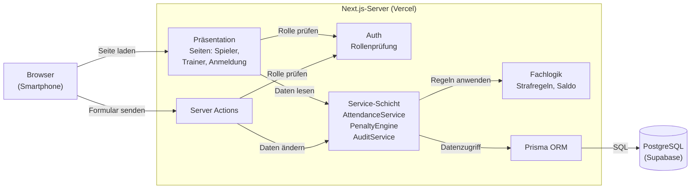
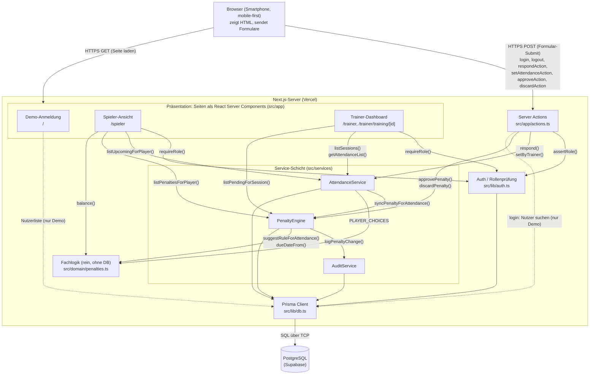

# Komponentenmodell (High-Level-Struktur)

> Entwurf für P3. Verantwortlich: Architektur & Entwurf. Notation: Komponentendiagramm in Anlehnung an UML, gezeichnet als Mermaid-Flowchart (Mermaid hat keinen eigenen UML-Komponententyp, rendert aber direkt auf GitHub).
>
> **Legende:** Kasten = Komponente, Zylinder = Datenbank, gruppierender Rahmen = Knoten bzw. Schicht, Pfeil = Konnektor (Aufruf in Pfeilrichtung), Pfeilbeschriftung = genutzte Schnittstelle bzw. Protokoll.

## Übersicht

## Detailansicht

Dieselbe Struktur mit allen Konnektoren und den genutzten Schnittstellen (Funktionsnamen).

Lesend greifen die Seiten direkt auf die Services zu, schreibend nur über Server Actions. Die gestrichelten Pfeile sind die Demo-Anmeldung, die die Nutzerliste ohne Service liest; sie wird zu P4 durch Supabase Auth ersetzt.

## Komponenten und Schnittstellen

| Komponente | Verantwortung | Angebotene Schnittstelle |
| --- | --- | --- |
| Demo-Anmeldung | Person aus der Demo-Liste wählen (bis Supabase Auth kommt) | – (UI) |
| Spieler-Ansicht | Rückmeldung zu Trainings, eigenes Kassenkonto mit Saldo | – (UI) |
| Trainer-Dashboard | Trainingsübersicht, Anwesenheit bestätigen, Strafvorschläge freigeben | – (UI) |
| Server Actions | Einstiegspunkt aller Schreibzugriffe, Rollenprüfung, Revalidierung | `login`, `logout`, `respondAction`, `setAttendanceAction`, `approveAction`, `discardAction` |
| Auth | aktuelle Person ermitteln, Rollen prüfen (REQ-SEC-01) | `getCurrentUser()`, `requireRole()`, `assertRole()`, `homeFor()`, `areasFor()` |
| AttendanceService | Rückmeldungen speichern, Anwesenheitsliste liefern | `respond()`, `setByTrainer()`, `listUpcomingForPlayer()`, `listSessions()`, `getAttendanceList()` |
| PenaltyEngine | Strafvorschlag nach Katalog, Freigabe, Verwerfen, Storno | `syncPenaltyForAttendance()`, `approvePenalty()`, `discardPenalty()`, `listPenaltiesForPlayer()`, `listPendingForSession()` |
| AuditService | unveränderliches Protokoll jeder Statusänderung einer Strafe | `logPenaltyChange()` |
| Fachlogik | reine Regeln ohne Seiteneffekte, unit-getestet | `suggestRuleForAttendance()`, `isOutstanding()`, `openAmount()`, `balance()`, `dueDateFrom()`, `PLAYER_CHOICES` |
| Prisma Client | Datenzugriff, Transaktionen | generiert aus `prisma/schema.prisma` |
