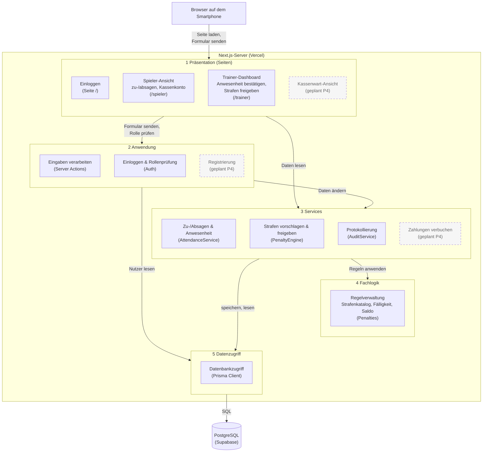
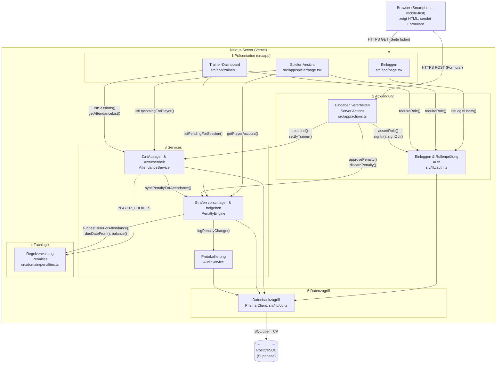

# Komponentenmodell und Schichtenarchitektur

> Überarbeitet nach dem P3-Feedback (09.11.2026): Die Kästen tragen jetzt konkrete Namen dessen, was die Komponente tut (z. B. „Einloggen & Rollenprüfung“, „Regelverwaltung“), statt abstrakter Schichtnamen. Komponentendiagramm und Schichtenarchitektur sind **ein und dasselbe Bild**: Die Rahmen sind die fünf Schichten, die Kästen darin die Komponenten. Alle Namen stehen in der [Namensliste](namensliste.md) und sind in allen Diagrammen gleich.
>
> **Legende:** Rahmen = Schicht (bzw. Knoten), Kasten = Komponente mit Codename in Klammern, Zylinder = Datenbank, Pfeil = Aufruf in Pfeilrichtung (nur von oben nach unten), Pfeilbeschriftung = genutzte Schnittstelle, gestrichelter Kasten = geplant für P4, noch nicht im Code.

## Übersicht

## Detailansicht

Dieselben Schichten und Komponenten mit allen Aufrufen und den genutzten Funktionen.

Lesend greifen die Seiten über die Services zu, schreibend nur über die Server Actions. Alle Pfeile zeigen nach unten; eine Schicht darf eine tiefere überspringen (gelockerte Schichtenarchitektur), aber nie nach oben zeigen. Die Seiten kennen weder die Datenbank noch die Fachlogik direkt. Begründung siehe [Architekturbegründung](architekturbegruendung.md).

## Komponenten und Schnittstellen

| Schicht | Komponente (Codename) | Verantwortung | Angebotene Schnittstelle |
| --- | --- | --- | --- |
| 1 Präsentation | Einloggen (`/`) | Person aus der Demo-Liste wählen, bis Registrierung und Login mit Supabase Auth kommen | – (UI) |
| 1 Präsentation | Spieler-Ansicht (`/spieler`) | Training zu- oder absagen, eigenes Kassenkonto mit Saldo | – (UI) |
| 1 Präsentation | Trainer-Dashboard (`/trainer`, `/trainer/training/[id]`) | Trainingsübersicht, Anwesenheit bestätigen, Strafvorschläge freigeben oder verwerfen | – (UI) |
| 1 Präsentation | Kassenwart-Ansicht (geplant P4, MVP-4/5) | alle Strafen, Zahlungen verbuchen | – (UI) |
| 2 Anwendung | Eingaben verarbeiten (Server Actions) | Einstieg aller Schreibzugriffe: Rolle prüfen, genau einen Service aufrufen, Seite aktualisieren | `login`, `logout`, `respondAction`, `setAttendanceAction`, `approveAction`, `discardAction` |
| 2 Anwendung | Einloggen & Rollenprüfung (Auth) | an- und abmelden, aktuelle Person ermitteln, Rollen prüfen (REQ-SEC-01) | `listLoginUsers()`, `signIn()`, `signOut()`, `getCurrentUser()`, `requireRole()`, `assertRole()`, `homeFor()`, `areasFor()` |
| 2 Anwendung | Registrierung (geplant P4) | eigenes Konto mit Supabase Auth anlegen | – |
| 3 Services | Zu-/Absagen & Anwesenheit (AttendanceService) | Rückmeldungen speichern, Anwesenheit durch den Trainer bestätigen, Anwesenheitsliste liefern | `respond()`, `setByTrainer()`, `listUpcomingForPlayer()`, `listSessions()`, `getAttendanceList()` |
| 3 Services | Strafen vorschlagen & freigeben (PenaltyEngine) | Strafvorschlag nach Katalog, Freigabe, Verwerfen, Storno, Kassenkonto | `syncPenaltyForAttendance()`, `approvePenalty()`, `discardPenalty()`, `listPenaltiesForPlayer()`, `getPlayerAccount()`, `listPendingForSession()` |
| 3 Services | Protokollierung (AuditService) | unveränderliches Protokoll jeder Statusänderung einer Strafe (REQ-AUD-01) | `logPenaltyChange()` |
| 3 Services | Zahlungen verbuchen (geplant P4, MVP-5) | Strafe als bar oder PayPal bezahlt markieren | – |
| 4 Fachlogik | Regelverwaltung (Penalties, `penalties.ts`) | Regeln des TSVK-Strafenkatalogs ohne Datenbank: welche Strafe greift, Fälligkeit, offener Betrag, Saldo; unit-getestet | `suggestRuleForAttendance()`, `isOutstanding()`, `openAmount()`, `balance()`, `dueDateFrom()`, `PLAYER_CHOICES`, `DUE_DAYS` |
| 5 Datenzugriff | Datenbankzugriff (Prisma Client) | Lesen, Schreiben, Transaktionen | generiert aus `prisma/schema.prisma` |
