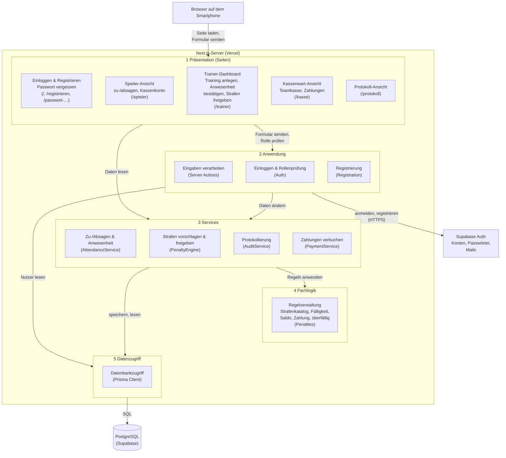
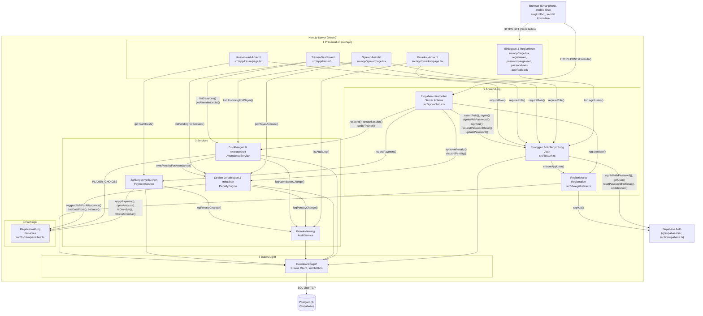

# Komponentenmodell und Schichtenarchitektur

> Überarbeitet nach dem P3-Feedback (09.11.2026): Die Kästen tragen jetzt konkrete Namen dessen, was die Komponente tut (z. B. „Einloggen & Rollenprüfung“, „Regelverwaltung“), statt abstrakter Schichtnamen. Komponentendiagramm und Schichtenarchitektur sind **ein und dasselbe Bild**: Die Rahmen sind die fünf Schichten, die Kästen darin die Komponenten. Alle Namen stehen in der [Namensliste](namensliste.md) und sind in allen Diagrammen gleich.
>
> **Legende:** Rahmen = Schicht (bzw. Knoten), Kasten = Komponente mit Codename in Klammern, Zylinder = Datenbank, Pfeil = Aufruf in Pfeilrichtung (nur von oben nach unten), Pfeilbeschriftung = genutzte Schnittstelle. Seit P4 (09.11.2026) sind alle Komponenten im Code, es gibt keine gestrichelten (geplanten) Kästen mehr.

## Übersicht

## Detailansicht

Dieselben Schichten und Komponenten mit allen Aufrufen und den genutzten Funktionen.

Lesend greifen die Seiten über die Services zu, schreibend nur über die Server Actions. Alle Pfeile zeigen nach unten; eine Schicht darf eine tiefere überspringen (gelockerte Schichtenarchitektur), aber nie nach oben zeigen. Die Seiten kennen weder die Datenbank noch die Fachlogik direkt. Begründung siehe [Architekturbegründung](architekturbegruendung.md).

## Komponenten und Schnittstellen

| Schicht | Komponente (Codename) | Verantwortung | Angebotene Schnittstelle |
| --- | --- | --- | --- |
| 1 Präsentation | Einloggen & Registrieren (`/`, `/registrieren`, `/passwort-vergessen`, `/passwort-neu`, `/auth/callback`) | mit E-Mail und Passwort anmelden, Konto anlegen, Passwort zurücksetzen, Links aus Mails von Supabase annehmen; für Präsentationen zusätzlich Demo-Anmeldung per Klick (abschaltbar mit `DEMO_LOGIN=off`) | – (UI) |
| 1 Präsentation | Spieler-Ansicht (`/spieler`) | Training zu- oder absagen, eigenes Kassenkonto mit Saldo | – (UI) |
| 1 Präsentation | Trainer-Dashboard (`/trainer`, `/trainer/neu`, `/trainer/training/[id]`) | Trainingsübersicht, Training anlegen (MVP-1), Anwesenheit bestätigen, Strafvorschläge freigeben oder verwerfen | – (UI) |
| 1 Präsentation | Kassenwart-Ansicht (`/kasse`, MVP-4/5) | Teamkasse: offene und bezahlte Strafen, Summen, Überfällige markiert; Zahlungen verbuchen (nur Kassenwart, Trainer liest mit) | – (UI) |
| 1 Präsentation | Protokoll-Ansicht (`/protokoll`, MVP-6) | Audit-Log lesen (Trainer und Kassenwart) | – (UI) |
| 2 Anwendung | Eingaben verarbeiten (Server Actions) | Einstieg aller Schreibzugriffe: Rolle prüfen, genau einen Service aufrufen, Seite aktualisieren | `login`, `loginWithPassword`, `registerAction`, `requestPasswordResetAction`, `updatePasswordAction`, `logout`, `respondAction`, `createSessionAction`, `setAttendanceAction`, `approveAction`, `discardAction`, `payAction` |
| 2 Anwendung | Einloggen & Rollenprüfung (Auth) | an- und abmelden über Supabase Auth bzw. Demo-Anmeldung (signiertes Cookie), Passwort zurücksetzen, aktuelle Person ermitteln, Rollen prüfen (REQ-SEC-01) | `listLoginUsers()`, `signIn()`, `signInWithPassword()`, `signOut()`, `requestPasswordReset()`, `updatePassword()`, `exchangeAuthLink()`, `isEmailLoginEnabled()`, `isDemoLoginEnabled()`, `getCurrentUser()`, `requireRole()`, `assertRole()`, `homeFor()`, `areasFor()` |
| 2 Anwendung | Registrierung (Registration, `registration.ts`) | Konto bei Supabase Auth anlegen und mit einem Spieler in `User` verknüpfen (`authId`); das Passwort kennt nur Supabase | `validateRegistration()`, `validateNewPassword()`, `registerUser()`, `ensureAppUser()`, `translateAuthError()` |
| extern | Supabase Auth | Konten, Passwörter, Sitzungs-Cookies, Mails (Bestätigung, Passwort vergessen) | REST-API über `@supabase/ssr` (`src/lib/supabase.ts`, `src/middleware.ts`) |
| 3 Services | Zu-/Absagen & Anwesenheit (AttendanceService) | Trainings anlegen, Rückmeldungen speichern, Anwesenheit durch den Trainer bestätigen (mit Protokoll), Anwesenheitsliste liefern | `createSession()`, `respond()`, `setByTrainer()`, `listUpcomingForPlayer()`, `listSessions()`, `getAttendanceList()` |
| 3 Services | Strafen vorschlagen & freigeben (PenaltyEngine) | Strafvorschlag nach Katalog, Freigabe, Verwerfen, Storno, Kassenkonto | `syncPenaltyForAttendance()`, `approvePenalty()`, `discardPenalty()`, `listPenaltiesForPlayer()`, `getPlayerAccount()`, `listPendingForSession()` |
| 3 Services | Protokollierung (AuditService) | unveränderliches Protokoll jeder Statusänderung einer Strafe und jeder vom Trainer gesetzten Anwesenheit (REQ-AUD-01) | `logPenaltyChange()`, `logAttendanceChange()`, `listAuditLog()` |
| 3 Services | Zahlungen verbuchen (PaymentService, MVP-4/5) | Zahlung bar oder PayPal verbuchen (auch Teilzahlung), Teamkasse mit Summen und Überfälligen | `recordPayment()`, `getTeamCash()` |
| 4 Fachlogik | Regelverwaltung (Penalties, `penalties.ts`) | Regeln des TSVK-Strafenkatalogs ohne Datenbank: welche Strafe greift, Fälligkeit, offener Betrag, Saldo, Zahlung und Teilzahlung, überfällig; unit-getestet | `suggestRuleForAttendance()`, `isOutstanding()`, `openAmount()`, `balance()`, `dueDateFrom()`, `applyPayment()`, `isOverdue()`, `weeksOverdue()`, `PLAYER_CHOICES`, `DUE_DAYS`, `LATE_FEE_CENTS_PER_WEEK` |
| 5 Datenzugriff | Datenbankzugriff (Prisma Client) | Lesen, Schreiben, Transaktionen | generiert aus `prisma/schema.prisma` |
