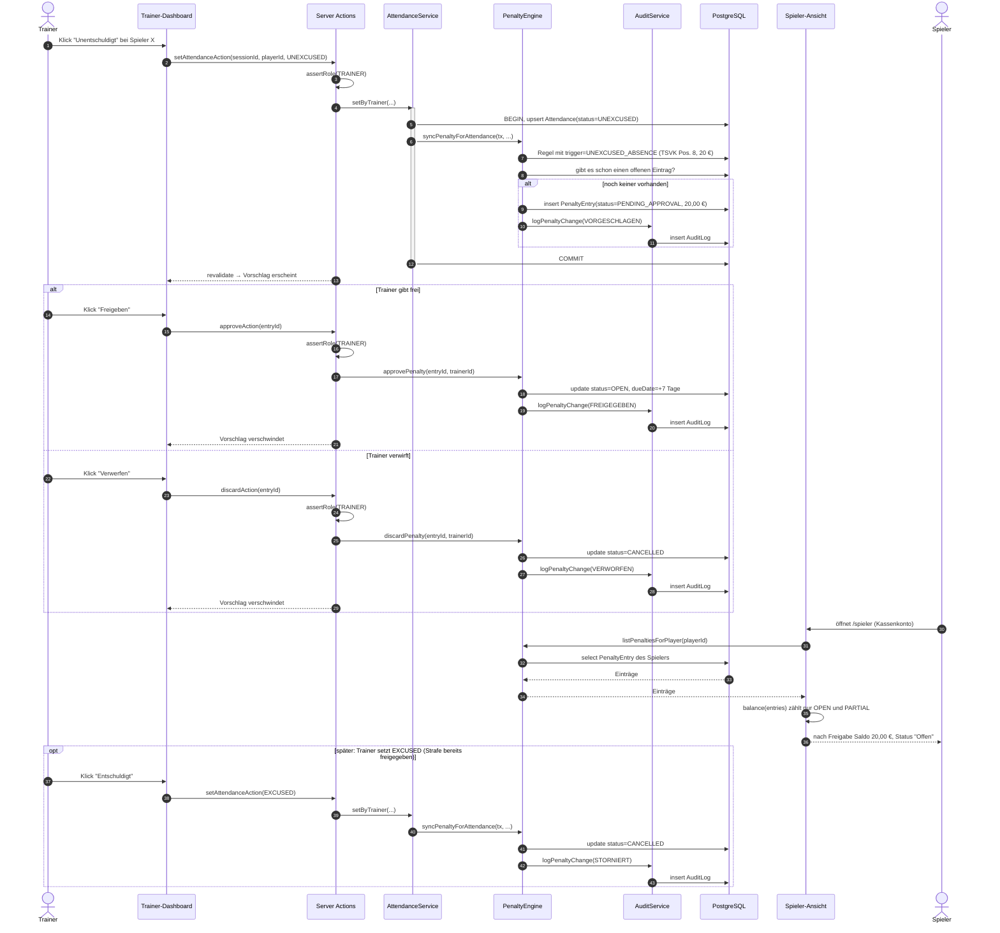
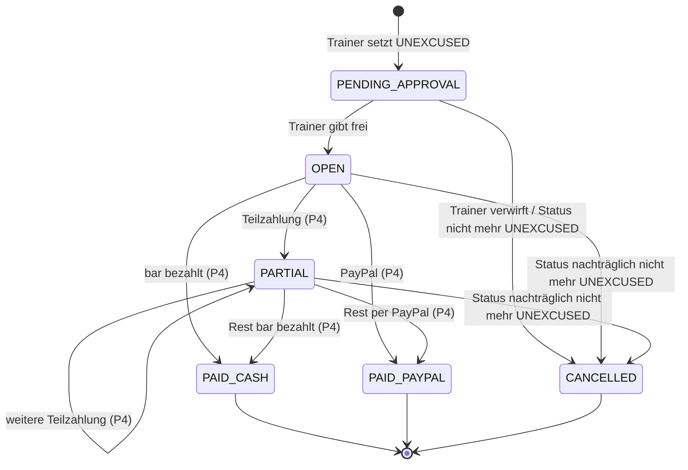

# Verhalten: Sequenzdiagramm REQ-PEN-02

> Entwurf für P3. Zeigt den Kernablauf der Demo: unentschuldigtes Fehlen → Strafvorschlag → Freigabe → Saldo.

## Zustandsautomat einer Strafe

Im Saldo zählen nur `OPEN` und `PARTIAL` (Funktion `isOutstanding` in `src/domain/penalties.ts`). Jeder Zustandswechsel wird im `AuditLog` protokolliert. Übergänge mit „(P4)“ sind modelliert, aber erst zu P4 umgesetzt.
