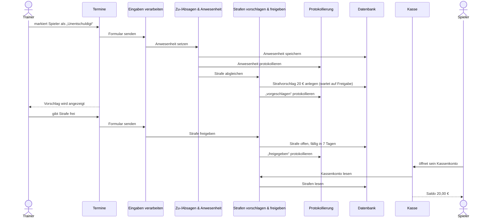
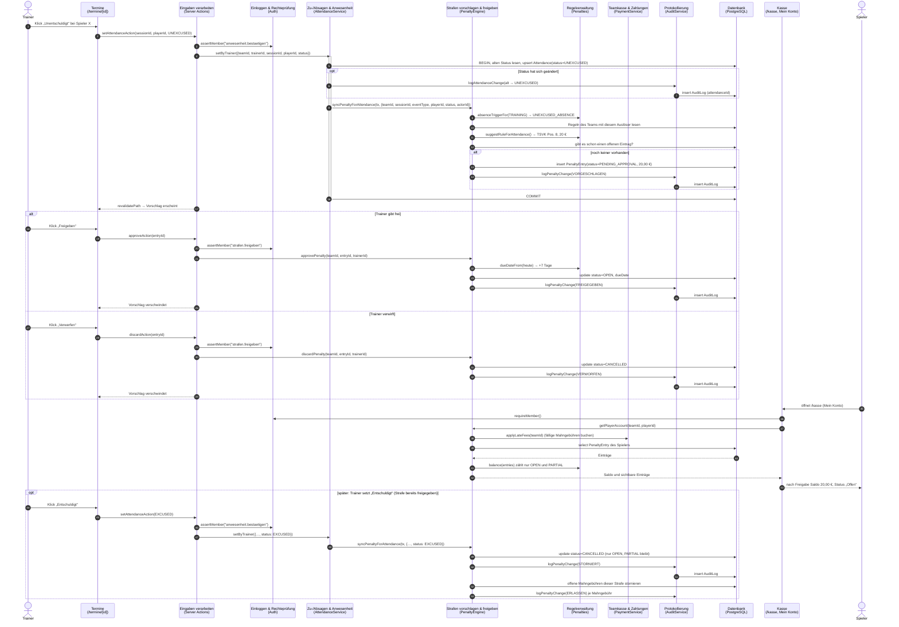
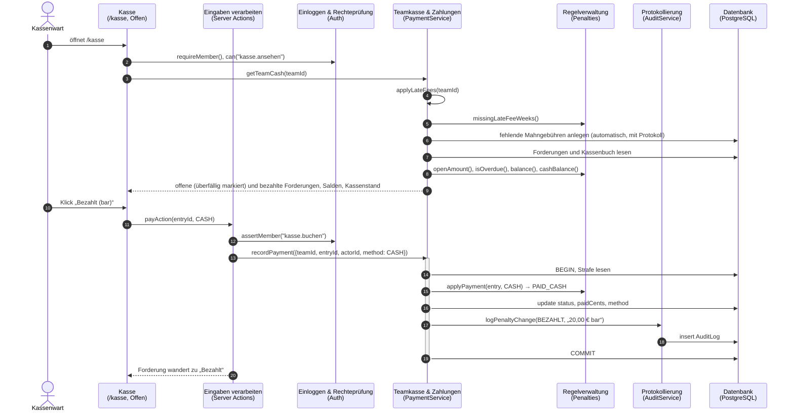
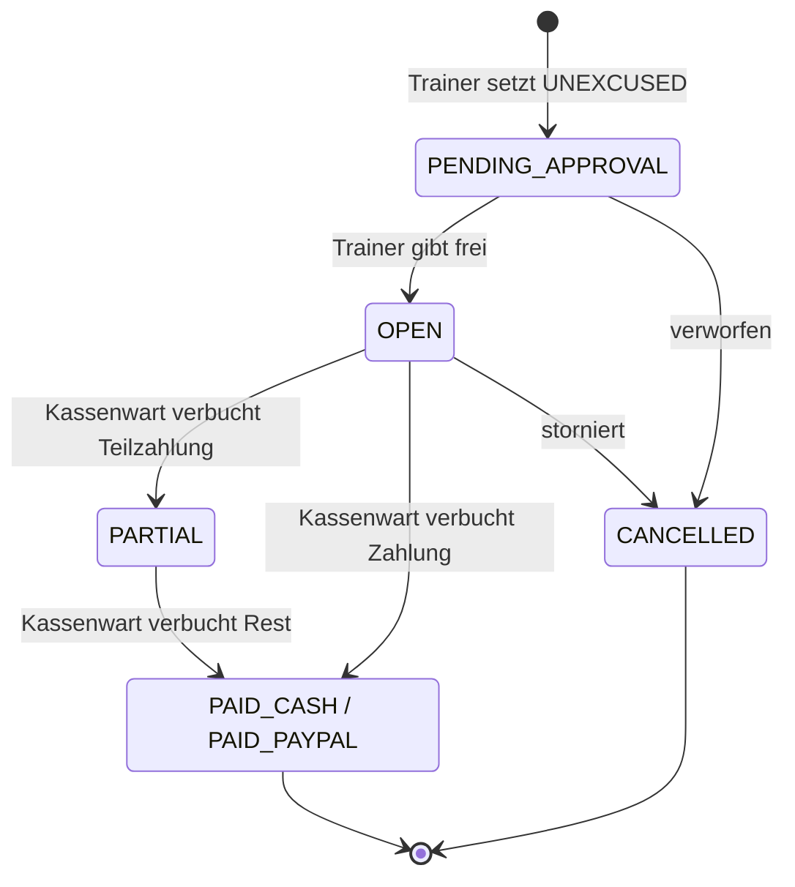
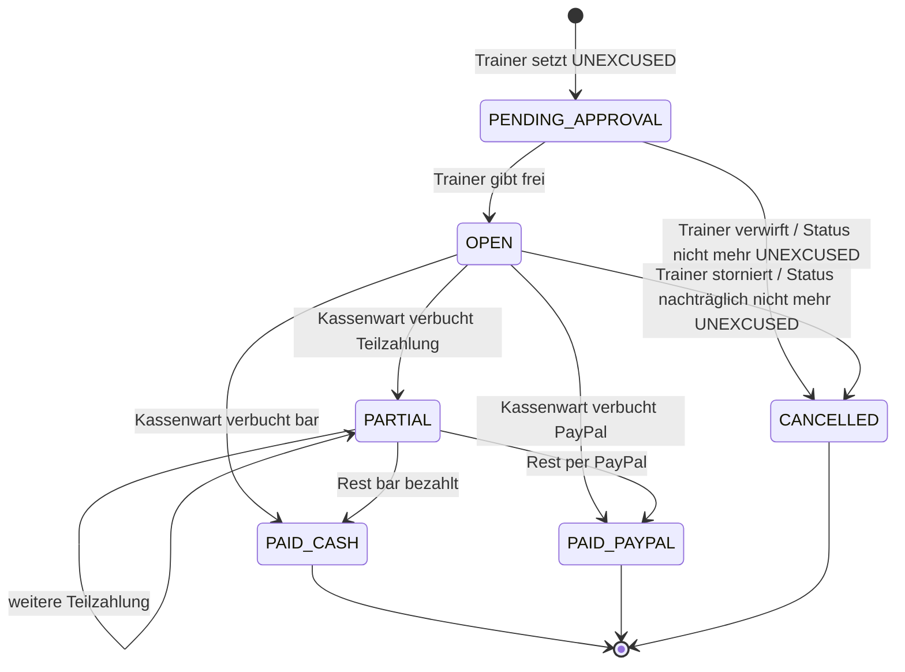

# Verhalten: Sequenzdiagramm REQ-PEN-02

> Stand Sprint „Features & Design“, 12.11.2026. Zeigt den Kernablauf: unentschuldigtes Fehlen beim Training → Strafvorschlag → Freigabe → Saldo, dazu die Zahlung beim Kassenwart (eigener Abschnitt unten). Die Teilnehmer heißen genauso wie die Komponenten im [Komponentendiagramm](komponenten.md) (siehe [Namensliste](namensliste.md)); die Übersicht zeigt dieselben Komponenten wie die Detailansicht, nur ohne Funktionsnamen. Bei einem Spiel läuft es genauso, nur mit Pos. 9 (40 €).

## Übersicht

## Detailansicht

Derselbe Ablauf mit allen Komponenten und Funktionsaufrufen, inklusive „Verwerfen“ und späterer Stornierung. Die Protokollierung schreibt jeden Eintrag in dieselbe Transaktion wie die Statusänderung.

## Sequenzdiagramm Zahlung verbuchen (REQ-PEN-04, MVP-5)

Der Kassenwart verbucht eine freigegebene Strafe mit einem Klick als bar oder per PayPal bezahlt. Mit Betrag wird eine Teilzahlung verbucht.

## Zustandsautomat einer Strafe

### Übersicht

### Detailansicht

Im Saldo zählen nur `OPEN` und `PARTIAL` (Funktion `isOutstanding` in `src/domain/penalties.ts`). Jeder Zustandswechsel wird im `AuditLog` protokolliert. Eine teilweise bezahlte Strafe (`PARTIAL`) wird nicht mehr automatisch storniert, wenn der Trainer die Anwesenheit ändert: Es ist schon Geld geflossen, das klärt der Kassenwart.

Manuelle Strafen (Kasse → Strafe vergeben) starten beim Trainer direkt in `OPEN`, bei Betreuer und Kassenwart in `PENDING_APPROVAL`. Beiträge starten in `OPEN`. Überfällig ist kein eigener Zustand: Für jede angefangene Woche nach der Frist legt `applyLateFees` automatisch eine eigene Forderung „Mahngebühr“ (`kind = LATE_FEE`, 5 €) in `OPEN` an, die denselben Zuständen folgt; der Kassenwart kann sie erlassen (`CANCELLED`, Protokoll „ERLASSEN“), dann kommt sie nicht wieder.
