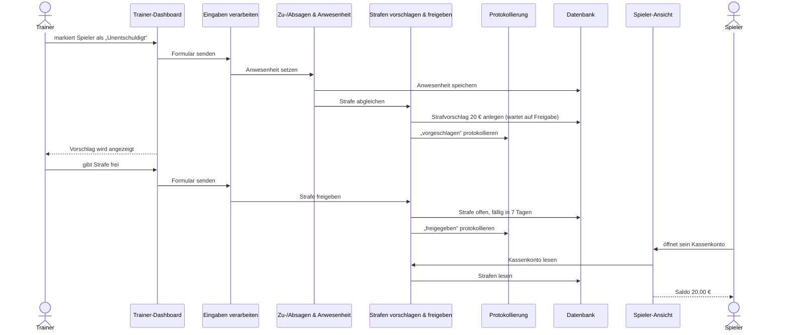
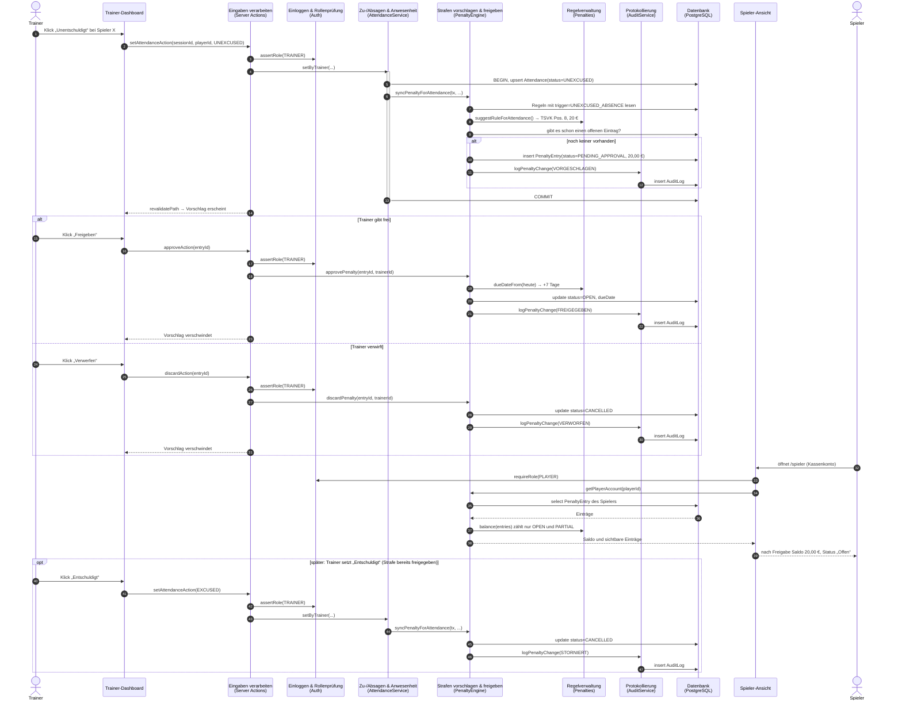
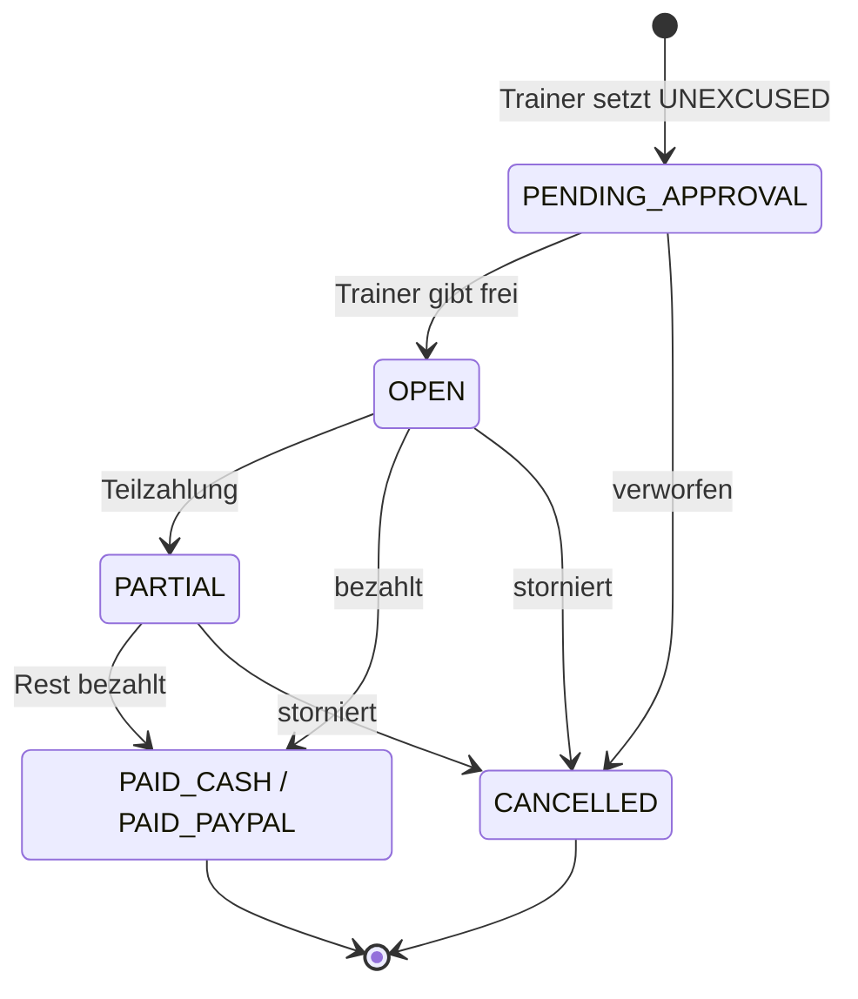
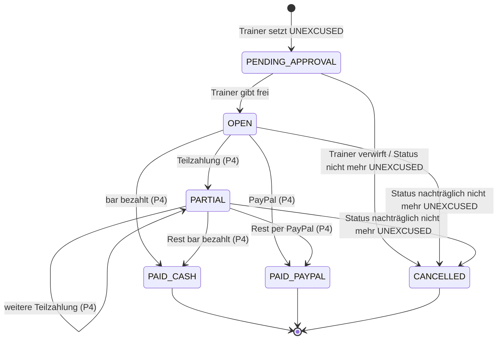

# Verhalten: Sequenzdiagramm REQ-PEN-02

> Zeigt den Kernablauf: unentschuldigtes Fehlen → Strafvorschlag → Freigabe → Saldo. Seit dem P3-Feedback (09.11.2026) heißen die Teilnehmer genauso wie die Komponenten im [Komponentendiagramm](komponenten.md) (siehe [Namensliste](namensliste.md)); die Übersicht zeigt dieselben Komponenten wie die Detailansicht, nur ohne Funktionsnamen.

## Übersicht

## Detailansicht

Derselbe Ablauf mit allen Komponenten und Funktionsaufrufen, inklusive „Verwerfen“ und späterer Stornierung. Die Protokollierung schreibt jeden Eintrag in dieselbe Transaktion wie die Statusänderung.

## Zustandsautomat einer Strafe

### Übersicht

### Detailansicht

Im Saldo zählen nur `OPEN` und `PARTIAL` (Funktion `isOutstanding` in `src/domain/penalties.ts`). Jeder Zustandswechsel wird im `AuditLog` protokolliert. Übergänge mit „(P4)“ sind modelliert, aber erst zu P4 umgesetzt.
