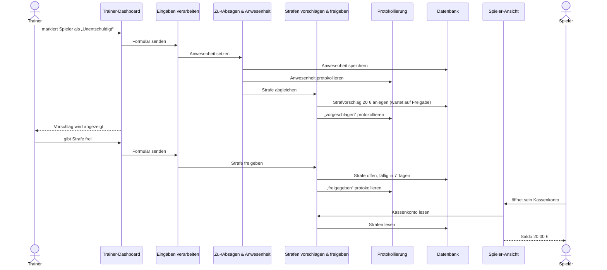
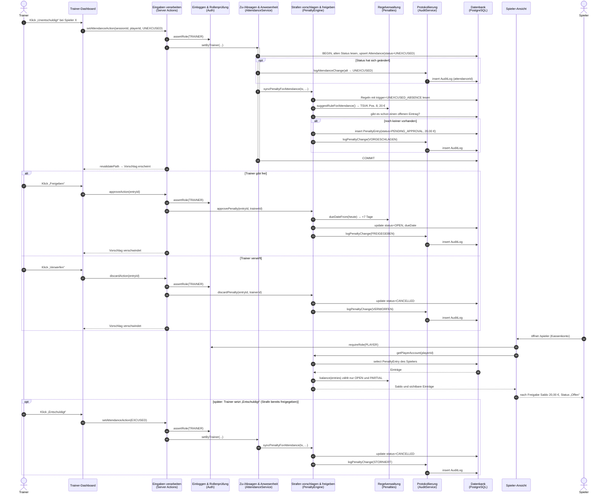
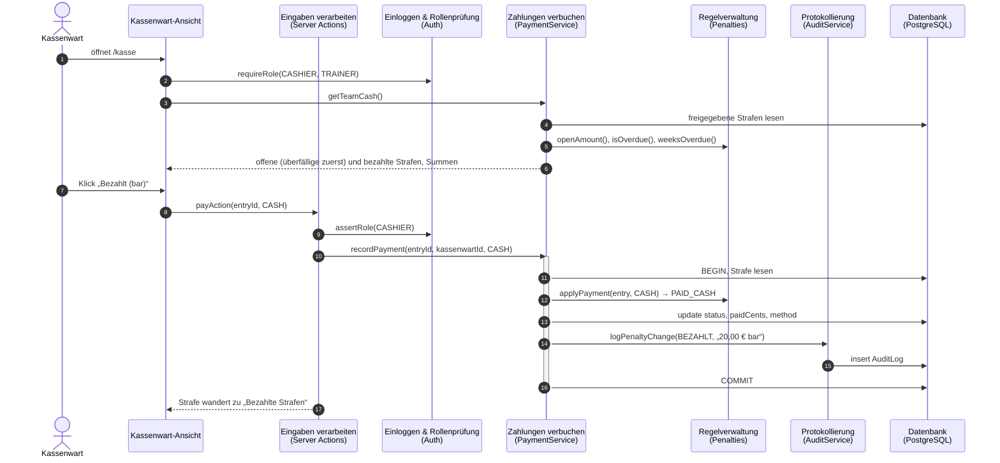
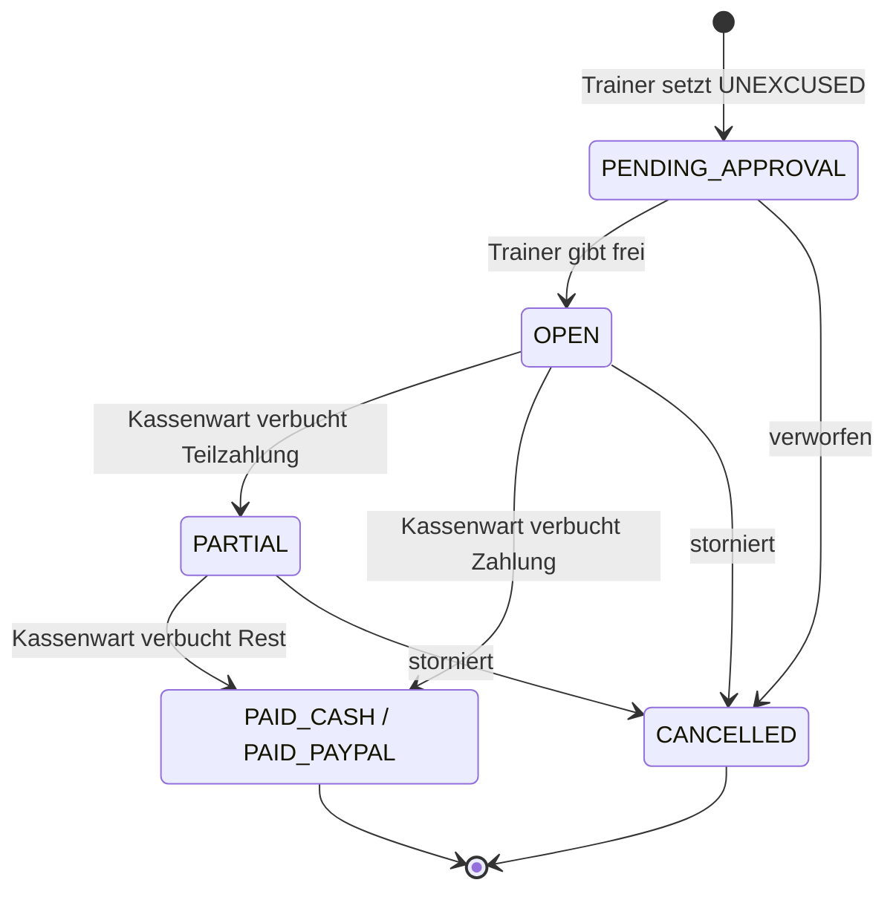
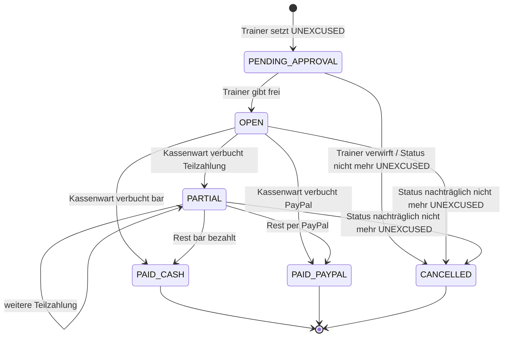

# Verhalten: Sequenzdiagramm REQ-PEN-02

> Zeigt den Kernablauf: unentschuldigtes Fehlen → Strafvorschlag → Freigabe → Saldo, dazu seit P4 die Zahlung beim Kassenwart (eigener Abschnitt unten). Seit dem P3-Feedback (09.11.2026) heißen die Teilnehmer genauso wie die Komponenten im [Komponentendiagramm](komponenten.md) (siehe [Namensliste](namensliste.md)); die Übersicht zeigt dieselben Komponenten wie die Detailansicht, nur ohne Funktionsnamen.

## Übersicht

## Detailansicht

Derselbe Ablauf mit allen Komponenten und Funktionsaufrufen, inklusive „Verwerfen“ und späterer Stornierung. Die Protokollierung schreibt jeden Eintrag in dieselbe Transaktion wie die Statusänderung.

## Sequenzdiagramm Zahlung verbuchen (REQ-PEN-04, MVP-5)

Der Kassenwart verbucht eine freigegebene Strafe mit einem Klick als bar oder per PayPal bezahlt. Mit Betrag wird eine Teilzahlung verbucht.

## Zustandsautomat einer Strafe

### Übersicht

### Detailansicht

Im Saldo zählen nur `OPEN` und `PARTIAL` (Funktion `isOutstanding` in `src/domain/penalties.ts`). Jeder Zustandswechsel wird im `AuditLog` protokolliert. Seit P4 sind alle Übergänge umgesetzt (Zahlungen: `recordPayment` im PaymentService, Regel `applyPayment` in der Regelverwaltung). Überfällig ist kein eigener Zustand: Eine Strafe in `OPEN` oder `PARTIAL` mit abgelaufener Frist wird in der Kassenwart-Ansicht nur markiert (`isOverdue`); die Mahngebühr von 5 € je Woche wird angezeigt, aber noch nicht automatisch gebucht.
